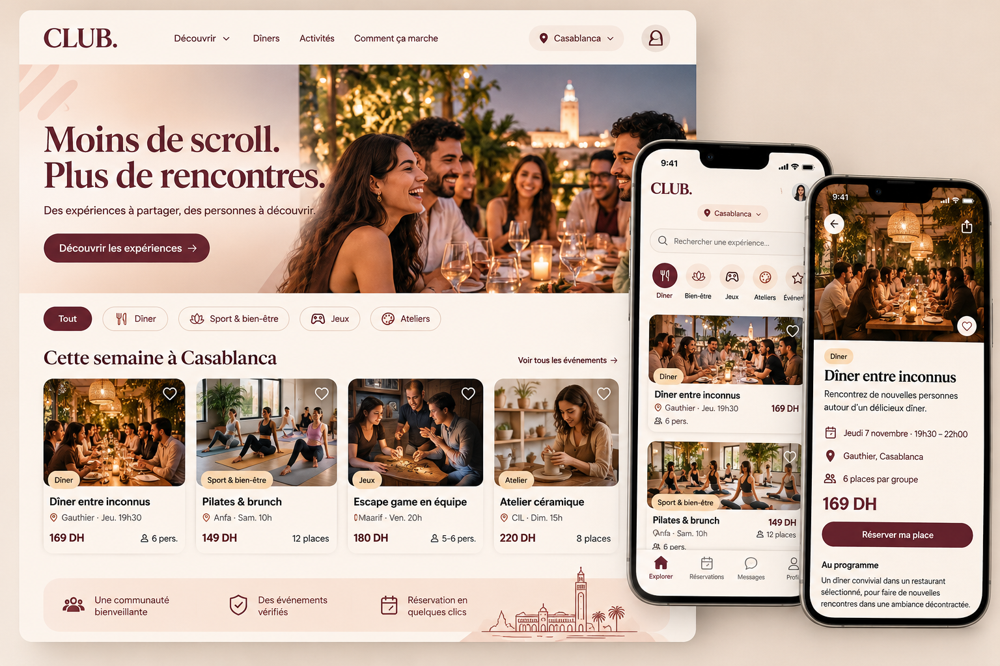

# 01 — Analyse produit

> Phase 1 · Document d'architecture · Statut : **validé**

## 1. Le produit en une phrase

Une plateforme lifestyle qui permet de **réserver sa place à des expériences réelles** (dîners, sport, jeux, ateliers, sorties) et d'y **rencontrer de nouvelles personnes**, seul ou accompagné, en commençant par Casablanca.

Ce n'est **pas** une application de rencontre amoureuse : on ne « matche » pas des personnes entre elles, on compose des **groupes** autour d'une expérience.

## 2. Ce qui différencie le produit

| Levier | Ce que ça implique techniquement |
|---|---|
| Les inconnus sont réunis par la plateforme (dîners, escape games) | Algorithme de constitution des groupes + validation par l'admin |
| Plusieurs univers (EAT, MOVE, PLAY, CREATE, DISCOVER) | Catégories configurables en base, pas codées en dur |
| Zéro organisation pour l'utilisateur | Paiement en ligne, rappels automatiques, lieu révélé au bon moment |
| Marque lifestyle premium | Design éditorial, mobile-first, grandes photos |
| Multi-villes dès le départ | Toutes les données sont rattachées à une `cityId` |

## 3. Les 5 modes de réservation

Ces modes sont le paramètre le plus important d'une expérience : ils changent la façon dont les places, les paiements et les groupes sont gérés.

| Mode (`bookingMode`) | Exemple | Qui réserve | Places | Groupes |
|---|---|---|---|---|
| `individual` | Pilates, 12 places | Chacun pour soi | 1 place par réservation | Non |
| `group` | Escape game 5–6 pers. | Chacun pour soi | 1 place | Oui, la plateforme regroupe (taille fixe) |
| `social_dinner` | Dîner 30 pers. → 5 tables de 6 | Chacun pour soi | 1 place | Oui, matching par score |
| `open` | Soirée rooftop | Seul ou accompagné | 1 à N places par réservation | Non |
| `private` | Atelier privatisé pour 8 amis | Un organisateur pour tout le groupe | Bloc complet | Le groupe est déjà constitué |

## 4. Les utilisateurs et leurs objectifs

| Rôle | Objectif principal | Interface |
|---|---|---|
| Visiteur | Découvrir, se laisser convaincre | Site public (SEO) |
| Utilisateur (`user`) | Réserver, payer, vivre l'expérience, donner son avis | Espace personnel |
| Organisateur / partenaire (`organizer`) | Voir ses événements et ses participants (plus tard : créer) | Back-office restreint — **désactivé au lancement** |
| Administrateur (`admin`) | Faire tourner l'activité au quotidien | Back-office complet |
| Super-administrateur (`superadmin`) | Gérer les admins, les paramètres sensibles, les remboursements exceptionnels | Back-office complet + paramètres |

## 5. Parcours critique (ce qui fait du chiffre d'affaires)

```
Découvrir → Fiche expérience → Choisir une date → Créer un compte / se connecter
→ Questionnaire (court) → Récapitulatif + code promo → Paiement
→ Confirmation (validée par le serveur) → Rappel J-1 + révélation du groupe/lieu
→ Expérience → Avis → Nouvelle réservation
```

Tout ce qui ne sert pas ce parcours au lancement est reporté (voir le plan dans [08](08-organisation-et-plan.md)).

## 6. Périmètre du MVP commercialisable

**Dans le MVP**

- Site public FR (accueil, catalogue, pages ville et catégorie, fiche expérience, pages institutionnelles)
- Comptes e-mail + questionnaire de profil
- Réservation avec gestion des capacités, liste d'attente, annulation
- Paiement en ligne réel via un prestataire marocain (après validation)
- Codes promo
- Back-office : expériences, sessions, réservations, participants, groupes (manuel + proposition automatique simple), paiements/remboursements, export CSV/Excel
- Notifications in-app + e-mail, rappel J-1
- Avis après l'expérience
- Statistiques de base (CA, remplissage, marge)

**Après le MVP**

- Arabe complet (l'architecture est multilingue dès le départ, voir décision D7)
- Notifications push (FCM), connexion Google / téléphone
- Espace organisateur/partenaire
- Abonnement premium, crédits/avoirs, parrainage
- Messagerie de groupe (voir point d'attention ci-dessous)
- WhatsApp Business (API officielle)
- Recherche plein texte avancée (Algolia/Typesense)

## 7. Lecture de la maquette de référence



La maquette fournie fixe une direction artistique claire, que nous reprenons :

- Fond crème, bordeaux/prune profond pour la marque et les CTA, noir doux pour le texte.
- Titres en serif éditorial à fort contraste, corps de texte en sans-serif.
- Cartes d'expérience : grande photo, badge de catégorie, favori (cœur), titre, quartier · jour heure, prix en DH, taille de groupe.
- Mobile : barre d'onglets en bas, recherche, puces de catégories en icônes.

**Écarts relevés entre la maquette et le cahier des charges (à arbitrer) :**

1. **Onglet « Messages »** dans la barre mobile : la messagerie n'est pas prévue au cahier des charges et implique de la modération (sécurité des participants). Proposition : remplacer par **« Notifications »** au lancement, messagerie de groupe dans une version ultérieure.
2. **Libellés de catégories** : la maquette affiche « Dîner, Sport & bien-être, Jeux, Ateliers » ; le cahier des charges définit EAT / MOVE / PLAY / CREATE / DISCOVER. Proposition : clés techniques `eat`, `move`, `play`, `create`, `discover` et libellés affichés « Dîners & gastronomie », « Sport & bien-être », « Jeux », « Ateliers », « Sorties ».
3. **Favoris (cœur)** : non listé au cahier des charges, mais présent sur toutes les cartes. Règle « pas de bouton décoratif » → on l'implémente (sous-collection `favorites`, simple) ou on le retire. Proposition : l'implémenter, coût faible et utile pour le remarketing.
4. **Nom** : la maquette affiche « CLUB. » ; le nom retenu est **The Community** (décision D1 validée).

## 8. Points d'attention produit spécifiques au Maroc

- **Sécurité et confiance** : on réunit des inconnus dans la vraie vie. Il faut dès le MVP une charte de bonne conduite acceptée à l'inscription, un bouton « signaler un participant » après l'expérience et la possibilité pour l'admin de suspendre un compte.
- **Alcool** : certaines expériences (rooftops, dîners) peuvent servir de l'alcool, d'autres non. Proposition : attribut `alcoholServed` affiché sur la fiche et filtrable.
- **Fuseau horaire** : le Maroc est en UTC+1 mais repasse en UTC+0 pendant le Ramadan. Toutes les dates sont stockées en UTC et affichées avec le fuseau IANA `Africa/Casablanca` — jamais avec un décalage codé en dur.
- **Ramadan** : formats spécifiques (ftour, shour) à prévoir comme tags/collections plutôt que comme catégories.
- **Paiement** : le taux d'équipement en carte bancaire en ligne est plus faible qu'en Europe. Le système doit pouvoir accueillir plus tard d'autres moyens (wallet mobile, paiement en espèces chez un partenaire), d'où l'abstraction du prestataire.
