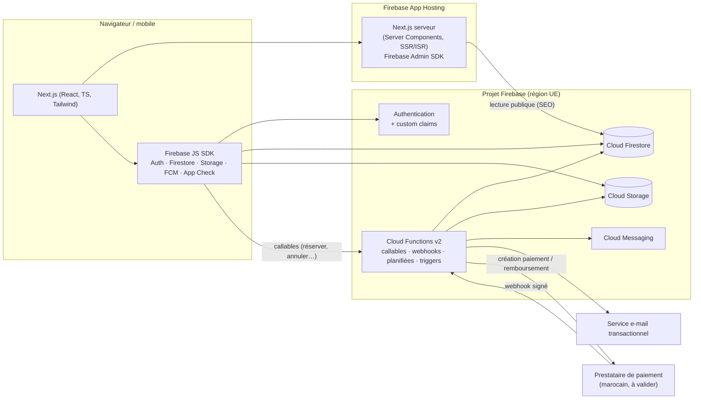

# 02 — Architecture technique

> Phase 1 · Document d'architecture · Statut : **validé**

## 1. Vue d'ensemble



**Principe directeur :** le navigateur **lit** beaucoup mais **n'écrit presque rien de sensible**. Tout ce qui touche à l'argent, aux places, aux rôles ou aux groupes passe par une Cloud Function qui utilise l'Admin SDK, dans une transaction Firestore. Les règles de sécurité interdisent ces écritures côté client.

## 2. Choix technologiques

| Couche | Choix | Pourquoi |
|---|---|---|
| Framework | **Next.js (App Router) + React + TypeScript** | SSR/ISR pour le SEO, un seul code pour public/utilisateur/admin |
| Style | **Tailwind CSS** + composants maison (pas de kit SaaS) | Direction artistique premium sur mesure ; support RTL via les variantes logiques (`ms-`, `me-`, `ps-`…) |
| i18n | **next-intl** | Routage par langue, messages ICU, compatible Server Components, gère `dir="rtl"` |
| Validation | **Zod**, schémas partagés front ↔ functions | Une seule définition des données, validée des deux côtés |
| Formulaires | React Hook Form + Zod | Formulaires admin rapides et typés |
| Dates | `date-fns` + `date-fns-tz` (fuseau `Africa/Casablanca`) | Gestion correcte de l'heure marocaine (changement pendant le Ramadan) |
| Hébergement | **Firebase App Hosting** | Support natif de Next.js SSR (Cloud Run géré), déploiement depuis GitHub, gestion des secrets via Secret Manager |
| Auth | Firebase Authentication (e-mail/mot de passe au lancement) | Google et téléphone activables plus tard sans refonte |
| Base de données | Cloud Firestore (mode natif) | Temps réel pour l'admin et les statuts de paiement, transactions pour les places |
| Fichiers | Cloud Storage for Firebase | Photos expériences, avatars, visuels |
| Backend | **Cloud Functions for Firebase v2** (Node.js 22, TypeScript) | Callables, webhooks HTTP, tâches planifiées, triggers Firestore |
| Push | Firebase Cloud Messaging | Phase 7 |
| Anti-abus | Firebase App Check (reCAPTCHA Enterprise sur le web) | Protège Firestore, Storage et les callables contre les scripts |
| E-mail | Prestataire transactionnel (hypothèse : **Brevo**), via une couche d'abstraction | Templates FR/AR, bonne délivrabilité ; remplaçable |
| Tests | Vitest, Firebase Emulator Suite, `@firebase/rules-unit-testing`, Playwright | Unitaires, règles de sécurité, intégration, E2E mobile |
| CI | GitHub Actions | Lint, typecheck, tests, émulateurs ; déploiement App Hosting lié à la branche |

Plan Firebase requis : **Blaze** (paiement à l'usage), nécessaire pour Cloud Functions, App Hosting et les appels sortants vers le prestataire de paiement. Le coût reste très faible au démarrage.

## 3. Région d'hébergement (décision structurante — D3)

- La localisation de Firestore est **définitive** une fois la base créée.
- À notre connaissance Google Cloud n'a pas de région au Maroc (**à vérifier au moment de la création**). L'option la plus proche est l'Europe.
- **Proposition : `europe-west1` (Belgique)** pour Firestore, Storage et Cloud Functions ; App Hosting dans la région européenne disponible la plus proche.
- Conséquence réglementaire : les données personnelles sont hébergées hors du Maroc → déclaration/autorisation de transfert auprès de la **CNDP** à prévoir avant le lancement commercial (voir [04](04-roles-et-securite.md#8-conformité-loi-09-08--cndp)).

## 4. Environnements

| Projet Firebase | Usage | Données |
|---|---|---|
| Émulateurs locaux | Développement quotidien et tests automatisés | Données de démonstration (`seed`), clairement marquées `isDemo: true` |
| `thecommunity-dev` | Recette en ligne, démos, prestataire de paiement en **mode test** | Démonstration |
| `thecommunity-prod` | Production | Réelles |

Un projet `staging` pourra être ajouté avant le lancement si nécessaire. Les projets sont totalement séparés (bases, comptes, clés). Aucune clé de production n'est utilisable en dev.

**Secrets** (clés prestataire de paiement, clé e-mail, secret de signature des webhooks) : stockés dans **Google Secret Manager** et injectés uniquement dans les Cloud Functions / le serveur Next.js. La configuration Firebase « web » (apiKey, projectId…) n'est pas un secret, elle peut être dans le front.

## 5. Rendu Next.js : qui lit quoi

| Zone | Rendu | Accès aux données |
|---|---|---|
| Pages publiques (accueil, ville, catégorie, fiche) | Server Components + **ISR** (revalidation ~60 s et revalidation à la demande lors d'une publication) | Admin SDK côté serveur, lecture des documents publiés uniquement |
| Disponibilité des places sur une fiche | Composant client en temps réel | Firestore SDK (lecture publique de la session) |
| Espace utilisateur | Client (après connexion) | Firestore SDK, protégé par les règles |
| Back-office | Client, route protégée | Firestore SDK (règles admin) + callables |
| Pages protégées (SSR) | Vérification d'un **cookie de session Firebase** côté serveur (middleware) | Admin SDK |

Le contrôle d'accès dans Next.js (middleware) sert au confort de navigation ; **la vraie barrière reste les règles Firestore et les vérifications dans les Cloud Functions**.

## 6. Multi-villes, multi-langues, multi-devises

- **Villes** : collection `cities`, chaque expérience/session/réservation porte `cityId`. Ajouter Rabat = créer un document `cities/rabat` et ses expériences. Aucun code à modifier.
- **Langues** : `fr` par défaut (URL sans préfixe), `ar` sous `/ar/…` (RTL), `en` plus tard sous `/en/…`. Les textes de l'interface sont dans des fichiers de messages ; les contenus éditoriaux (titres, descriptions) sont stockés en base sous forme de champs localisés `{ fr: "...", ar: "..." }`.
- **Devises** : tous les montants sont des **entiers en centimes** (`amount: 16900` = 169,00 DH) accompagnés d'un code `currency: "MAD"`. Jamais de nombres à virgule pour l'argent. La devise est portée par la ville.

## 7. Abstraction du paiement

Le reste de l'application ne connaît pas le prestataire. Il appelle une interface unique, implémentée par un adaptateur par prestataire :

```ts
// Contrat (illustratif, pas encore du code livré)
interface PaymentProvider {
  id: "cmi" | "payzone" | "youcanpay" | "sandbox" | string;
  createCheckout(input: CheckoutInput): Promise<CheckoutSession>;   // URL ou formulaire de redirection
  verifyWebhook(req: RawRequest): Promise<VerifiedEvent>;           // signature/hash, sinon rejet
  refund(input: RefundInput): Promise<RefundResult>;
  getStatus(providerRef: string): Promise<ProviderPaymentStatus>;   // réconciliation
}
```

- La confirmation d'une réservation est **uniquement** déclenchée par un webhook vérifié (ou une réconciliation serveur), jamais par la page de retour du navigateur.
- Le numéro de carte ne transite jamais par nos serveurs : page de paiement hébergée par le prestataire.
- Un adaptateur `sandbox` existe **uniquement sur les émulateurs et le projet dev**, désactivé par configuration en production, et affiché comme « Paiement de test » dans l'interface. Il ne simule pas un paiement réel ; il sert aux tests automatisés du parcours.

**Prestataires candidats (compatibilité à vérifier, aucun n'est supposé compatible) :**

| Prestataire | Points à vérifier |
|---|---|
| CMI (Centre Monétique Interbancaire), via la banque de l'entreprise | Contrat e-commerce bancaire, délais d'ouverture, frais, cartes internationales, API de remboursement, callback serveur signé |
| Payzone | Agrément, frais, webhooks, remboursements partiels, environnement de test |
| YouCan Pay | Idem + conditions pour une société de services/événementiel |
| Prestataires internationaux (Stripe, etc.) | À notre connaissance non disponibles pour une société marocaine encaissant en MAD — **à confirmer** ; problématique de change (Office des Changes) |

Pré-requis commun probable : **une société marocaine avec un compte bancaire professionnel** (décision D2). L'ouverture d'un contrat e-commerce peut prendre plusieurs semaines → à lancer en parallèle du développement.

## 8. Notifications

Un service unique `notify(userId, type, payload)` dans les Cloud Functions :

1. écrit une notification in-app (`users/{uid}/notifications`) ;
2. envoie un e-mail via l'adaptateur e-mail (template localisé) si l'utilisateur ne l'a pas désactivé ;
3. envoie un push FCM si l'utilisateur a des appareils enregistrés (phase 7).

WhatsApp sera un canal supplémentaire branché sur ce même service, via l'API officielle WhatsApp Business ; le fonctionnement de base n'en dépend pas.

## 9. Recherche et filtres

Firestore ne fait pas de recherche plein texte. Pour le lancement (dizaines de sessions par ville), les filtres reposent sur des requêtes indexées (ville, catégorie, date, statut) et un tri/filtre complémentaire côté serveur (prix, texte). Quand le catalogue dépassera quelques centaines d'expériences actives, on branchera Algolia ou Typesense via l'extension Firebase correspondante, sans changer le modèle de données.

## 10. Observabilité

- Cloud Logging pour les functions (logs structurés, identifiant de corrélation par réservation).
- Alertes : erreurs de webhook, réservations bloquées en `pending_payment`, échecs d'envoi d'e-mail.
- Journal d'audit métier dans Firestore (`auditLogs`) pour les actions sensibles (voir [04](04-roles-et-securite.md)).
- Analytics : Google Analytics 4 (via Firebase) chargé **uniquement après consentement**, événements de conversion `view_item`, `begin_checkout`, `purchase`.
