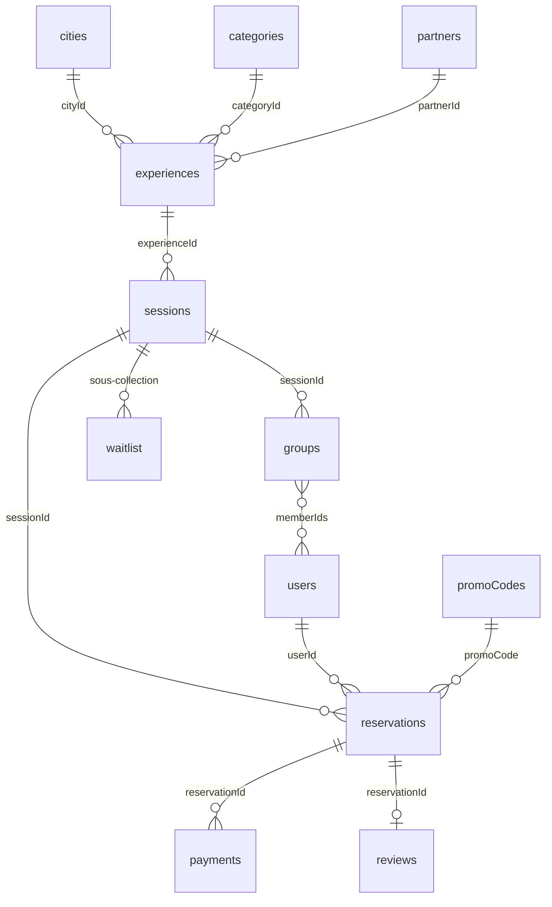

# 03 — Modèle de données Firestore

> Phase 1 · Document d'architecture · Statut : **validé**

## 1. Conventions

| Règle | Détail |
|---|---|
| Montants | Entiers en **centimes** + `currency` (`"MAD"`). Ex. `16900` = 169,00 DH |
| Dates | `Timestamp` Firestore (UTC). Affichage avec `cities.timezone` (`Africa/Casablanca`) |
| Textes éditoriaux | Champ localisé `LocalizedText = { fr: string; ar?: string; en?: string }` |
| Identifiants | Auto-générés, sauf mention (slugs, codes promo, clés de catégorie) |
| Horodatage | `createdAt`, `updatedAt` écrits par le serveur (`serverTimestamp()`) |
| Données de démo | `isDemo: true` sur tout document de démonstration (purge facile) |
| Champs serveur | Marqués 🔒 : jamais modifiables par un client, même admin, sauf via Cloud Function |
| Dénormalisation | Uniquement des « instantanés » (snapshots) utiles à l'affichage, resynchronisés par trigger |

## 2. Décision clé : Expérience ≠ Session (décision D4)

Le cahier des charges parle d'« expérience » et d'« événement ». Nous proposons de séparer :

- **Expérience** (`experiences`) = le concept, la fiche durable : « Dîner entre inconnus — Gauthier », « Pilates & brunch ». C'est la page indexée par Google, qui accumule les avis.
- **Session** (`sessions`) = une date précise de cette expérience, avec sa capacité et ses places : « jeudi 7 novembre, 19h30, 30 places ».

Un événement ponctuel = une expérience avec une seule session. Un cours de Pilates hebdomadaire = une expérience, 52 sessions. Le formulaire admin crée les deux en une seule étape.

**Pourquoi :** réservations, capacités, groupes et paiements sont attachés à une date ; le SEO, les photos, la description et les avis sont attachés au concept. Sans cette séparation, il faudrait dupliquer la fiche à chaque date et les avis seraient éparpillés.

## 3. Schéma des relations

## 4. Collections

### `users/{uid}` — profil privé
Lisible/modifiable par son propriétaire (champs limités) et par les admins. **Jamais lisible par les autres utilisateurs.**

| Champ | Type | Note |
|---|---|---|
| `firstName`, `lastName` | string | |
| `email` | string | Copie de Auth, 🔒 |
| `phone` | string? | Format E.164 |
| `birthDate` | Timestamp | Sert au calcul de la tranche d'âge (matching), jamais affichée aux autres |
| `gender` | `"female" \| "male" \| "undisclosed"`? | **Facultatif, à valider (D5)** — uniquement pour équilibrer les tables |
| `cityId` | string | |
| `photoPath` | string? | Chemin Storage |
| `languages` | string[] | `["fr","ar","darija","en","es"]` |
| `interests` | string[] | Clés : `gastronomy, sport, travel, culture, art, music, wellness, games, nightlife, discovery` |
| `socialGoals` | string[] | `meet_new_people, expand_circle, discover_activities, go_out_more, share_passions` |
| `profession`, `bio` | string? | Facultatifs |
| `locale` | `"fr" \| "ar" \| "en"` | |
| `onboardingCompleted` | boolean | |
| `consents` | `{ terms: Timestamp, privacy: Timestamp, codeOfConduct: Timestamp, marketing: boolean, marketingAt?: Timestamp }` | Preuve de consentement |
| `notificationPrefs` | `{ email: boolean, push: boolean, marketingEmail: boolean }` | |
| `role` | `"user" \| "organizer" \| "admin" \| "superadmin"` | 🔒 Miroir du custom claim, pour l'affichage admin |
| `status` | `"active" \| "suspended" \| "deletion_requested" \| "deleted"` | 🔒 |
| `stats` | `{ bookings: number, attended: number, noShows: number, cancellations: number }` | 🔒 |
| `createdAt`, `updatedAt` | Timestamp | 🔒 |

Sous-collections :
- `users/{uid}/notifications/{id}` — `type, title: LocalizedText, body: LocalizedText, link, readAt?, createdAt`. Le propriétaire peut seulement marquer comme lu.
- `users/{uid}/devices/{token}` — jetons FCM (phase 7).
- `users/{uid}/favorites/{experienceId}` — `createdAt`.

### `userMatching/{uid}` — données de matching 🔒
Serveur uniquement (admins en lecture). `ageBand`, `recentCoParticipants: { uid: lastSeenAt }` (limité aux N derniers mois), `groupFeedbackScore`. Séparé de `users` car les règles Firestore ne peuvent pas masquer un champ : tout ce qui ne doit pas être lu par l'utilisateur est dans un autre document.

### `cities/{cityId}` — ex. `casablanca`
`name: LocalizedText`, `countryCode: "MA"`, `timezone: "Africa/Casablanca"`, `currency: "MAD"`, `isActive`, `isComingSoon`, `order`, `heroImagePath`, `districts: string[]` (Gauthier, Maarif, Anfa, CIL…), `seo: { title: LocalizedText, description: LocalizedText }`. Lecture publique.

### `categories/{categoryKey}` — ex. `eat`
`name: LocalizedText`, `description: LocalizedText`, `icon`, `color`, `imagePath`, `order`, `isActive`, `defaultBookingMode`, `subcategories: { key, name: LocalizedText }[]` (ex. `eat` → `social_dinner, brunch, food_tour…`), `seo`. Lecture publique. Ajouter une catégorie = ajouter un document.

### `partners/{partnerId}` — admin uniquement
`name`, `type` (`restaurant, studio, venue, workshop, other`), `cityId`, `address`, `contact { name, email, phone }`, `defaultCommission { type: "percent" | "fixed", value }`, `payoutInfo` (RIB — chiffrage/accès superadmin à discuter), `organizerUids: string[]`, `status`, `notes`. Les informations publiques utiles (nom, logo) sont copiées dans l'expérience (`partnerSnapshot`).

### `experiences/{experienceId}` — la fiche
| Champ | Type | Note |
|---|---|---|
| `slug` | string | Unique, ex. `diner-entre-inconnus-casablanca` |
| `title`, `summary`, `description` | LocalizedText | |
| `categoryId`, `subcategory` | string | |
| `cityId`, `district` | string | |
| `tags` | string[] | Pages thématiques SEO, filtres (`ramadan`, `sans-alcool`, `en-plein-air`…) |
| `partnerId` | string? | |
| `partnerSnapshot` | `{ name, logoPath }`? | |
| `venue` | `{ name, address, geo?: GeoPoint, revealPolicy: "immediate" \| "on_group_reveal" }` | Le lieu exact peut n'être révélé qu'avec le groupe (dîners) |
| `images` | `{ path, alt: LocalizedText }[]` | Première = couverture |
| `durationMinutes` | number | |
| `price` | `{ amount: number, currency }` | Prix par défaut d'une place |
| `bookingMode` | `individual \| group \| social_dinner \| open \| private` | |
| `groupConfig` | `{ minSize, targetSize, maxSize }`? | Modes `group`, `social_dinner` |
| `maxSeatsPerBooking` | number | 1 par défaut ; >1 pour `open` ; bloc pour `private` |
| `ageRange` | `{ min?, max? }`? | Optionnel (ex. 25-40) |
| `languages` | string[] | Langue(s) de l'expérience |
| `alcoholServed` | boolean? | |
| `included`, `practicalInfo`, `bookingConditions` | LocalizedText | |
| `cancellationPolicyId` | string | Référence `settings/cancellationPolicies` |
| `economics` | `{ model: "own" \| "commission", costPerSeat?: number, commissionType?, commissionValue? }` | Pour la marge. **Admin uniquement** → stocké en réalité dans `experiences/{id}/private/economics` |
| `status` | `draft \| published \| archived` | |
| `ratingAvg`, `ratingCount` | number | 🔒 |
| `nextSessionAt` | Timestamp? | 🔒 Pour trier le catalogue |
| `seo` | `{ title?, description?, ogImagePath? }` | |
| `createdBy`, `createdAt`, `updatedAt` | | |

> Le coût et la commission ne doivent pas être lisibles par le public : ils vivent dans la sous-collection `experiences/{id}/private/economics` (admin uniquement).

### `sessions/{sessionId}` — une date
| Champ | Type | Note |
|---|---|---|
| `experienceId` | string | |
| `experienceSnapshot` | `{ title, slug, coverImagePath, categoryId, bookingMode, district }` | Pour afficher les listes sans 2e lecture |
| `cityId`, `categoryId` | string | Dupliqués pour les requêtes du catalogue |
| `startAt`, `endAt` | Timestamp | |
| `price` | `{ amount, currency }` | Peut différer du prix par défaut |
| `capacity` | number | Modifiable par l'admin via callable (jamais < places prises) |
| `seatsConfirmed` | number | 🔒 |
| `seatsHeld` | number | 🔒 Places bloquées le temps du paiement |
| `waitlistCount` | number | 🔒 |
| `status` | `draft \| published \| full \| cancelled \| completed` | `full` calculé par le serveur |
| `bookingOpensAt`, `bookingClosesAt` | Timestamp? | Ex. fermeture 12 h avant |
| `groupsStatus` | `none \| proposed \| validated \| revealed` | 🔒 |
| `revealAt` | Timestamp? | Moment où les participants voient leur groupe et le lieu |
| `venueOverride` | objet? | Si le lieu change pour cette date |
| `isFeatured` | boolean | Mise en avant accueil |
| `createdAt`, `updatedAt` | | |

Places disponibles = `capacity − seatsConfirmed − seatsHeld`.

Sous-collections (serveur uniquement, admin en lecture) :
- `sessions/{id}/seatLocks/{uid}` — garde d'unicité : un utilisateur = une réservation active par session. Contient `reservationId`.
- `sessions/{id}/waitlist/{uid}` — `seats, createdAt, status: waiting | offered | expired | converted, offerExpiresAt`. L'utilisateur peut lire sa propre entrée.

### `reservations/{reservationId}`
| Champ | Type | Note |
|---|---|---|
| `userId`, `sessionId`, `experienceId`, `cityId`, `categoryId` | string | |
| `seats` | number | 1 sauf modes `open`/`private` |
| `guestNames` | string[]? | Accompagnants (mode `open`/`private`) |
| `status` | `pending_payment \| confirmed \| cancelled \| expired \| refunded \| attended \| no_show` | 🔒 |
| `holdExpiresAt` | Timestamp | 🔒 Fin du blocage (15 min par défaut, paramétrable) |
| `pricing` | `{ unitAmount, seats, subtotal, discount, fees, total, currency }` | 🔒 Calculé uniquement par le serveur |
| `promoCode` | string? | |
| `paymentId` | string? | Dernier paiement |
| `groupId` | string? | 🔒 |
| `sessionSnapshot` | `{ title, startAt, district, coverImagePath }` | Pour « Mes réservations » |
| `cancellation` | `{ at, by: "user" \| "admin" \| "system", reason, refundAmount }`? | |
| `checkedInAt` | Timestamp? | |
| `source` | `{ utmSource?, utmCampaign? }`? | Attribution marketing |
| `createdAt`, `updatedAt` | | |

Lecture : le propriétaire et les admins. Écriture : **jamais depuis le client**.

Sous-collection `reservations/{id}/private/finance` 🔒 (admin) : `gross, cost, commission, discount, pspFeesEstimate, margin` figés au moment du paiement (voir [06 §6](06-cloud-functions.md#6-calcul-financier)).

### `payments/{paymentId}` 🔒
`reservationId`, `userId`, `type: "payment" | "refund"`, `provider`, `providerRef`, `amount`, `currency`, `status: initiated | succeeded | failed | cancelled | refunded | partially_refunded`, `failureReason?`, `parentPaymentId?` (remboursement), `processedEventIds: string[]`, `createdAt`, `updatedAt`. Le propriétaire peut lire ses paiements ; aucune écriture client.

### `paymentEvents/{providerEventId}` 🔒
Journal brut des webhooks reçus (après vérification) : garantit l'**idempotence** (un même webhook reçu deux fois n'est traité qu'une fois). Serveur uniquement.

### `groups/{groupId}`
| Champ | Type | Note |
|---|---|---|
| `sessionId`, `experienceId` | string | |
| `label` | string | « Table 3 », « Équipe B » |
| `memberIds` | string[] | |
| `members` | `{ uid, firstName, photoPath?, interests: string[] }[]` | **Seulement** les infos nécessaires à l'expérience |
| `status` | `proposed \| validated \| revealed` | |
| `source` | `algorithm \| manual` | |
| `createdAt`, `updatedAt` | | |

Lecture participant : uniquement si `uid ∈ memberIds` **et** `status == "revealed"`. Sous-collection `groups/{id}/private/matching` (admin) : score, détail du score, alertes (« 2 personnes déjà réunies le 12/10 »).

### `reviews/{reservationId}`
`userId`, `sessionId`, `experienceId`, `partnerId?`, `rating (1–5)`, `comment?`, `publicName` (« Sara B. »), `status: published | hidden`, `createdAt`. Retour privé séparé (`reviews/{id}/private/feedback` : ambiance du groupe, signalement) lisible admin uniquement. Créé via callable (vérifie que la réservation est `attended` ou `confirmed` et passée).

### `promoCodes/{CODE}` — admin uniquement
`type: "percent" | "fixed"`, `value`, `currency?`, `validFrom`, `validTo`, `maxRedemptions`, `redemptionsCount` 🔒, `perUserLimit`, `minAmount?`, `firstBookingOnly`, `scope { cityIds?, categoryIds?, experienceIds? }`, `isActive`, `createdBy`. Sous-collection `redemptions/{reservationId}` (`userId`, `amount`, `at`). Validation exclusivement côté serveur.

### `settings/*`
- `settings/public` — lecture publique : langues actives, villes ouvertes, drapeaux de fonctionnalités, liens réseaux sociaux.
- `settings/booking` — admin : durée de blocage paiement, délai de fermeture des réservations, frais de service.
- `settings/cancellationPolicies` — politiques nommées : `{ id, label, rules: [{ hoursBefore: 48, refundPercent: 100 }, { hoursBefore: 0, refundPercent: 0 }] }`. Lisible publiquement (affichée sur les fiches).
- `settings/payment` — superadmin : prestataire actif, mode test/production.

### Collections de support
| Collection | Rôle | Accès |
|---|---|---|
| `auditLogs/{id}` | `actorUid, actorRole, action, targetType, targetId, before?, after?, at, ip?` | Écriture serveur, lecture admin |
| `statsDaily/{yyyy-mm-dd}_{cityId}` | Agrégats : CA brut, commissions, coûts, marge, réservations, annulations, taux de remplissage, par catégorie | Écriture serveur, lecture admin |
| `contactMessages/{id}` | Formulaire de contact | Création publique (validée + App Check), lecture admin |
| `reports/{id}` | Signalement d'un participant | Création par un participant de la même session, lecture admin |
| `dataRequests/{id}` | Demandes de suppression/export (loi 09-08) | Création par l'utilisateur, traitement serveur |
| `mail/{id}` | File d'envoi d'e-mails (si extension « Trigger Email ») | Serveur uniquement |

## 5. Index composites prévus

| Collection | Champs | Usage |
|---|---|---|
| `sessions` | `cityId ASC, status ASC, startAt ASC` | « Cette semaine à Casablanca » |
| `sessions` | `cityId ASC, categoryId ASC, status ASC, startAt ASC` | Page catégorie |
| `sessions` | `experienceId ASC, status ASC, startAt ASC` | Dates d'une fiche |
| `sessions` | `cityId ASC, isFeatured ASC, startAt ASC` | Mises en avant |
| `experiences` | `cityId ASC, status ASC, nextSessionAt ASC` | Catalogue |
| `experiences` | `cityId ASC, categoryId ASC, status ASC, nextSessionAt ASC` | Catalogue filtré |
| `experiences` | `tags ARRAY_CONTAINS, cityId ASC, status ASC` | Pages thématiques |
| `reservations` | `userId ASC, createdAt DESC` | Mes réservations |
| `reservations` | `sessionId ASC, status ASC` | Participants d'une session |
| `reservations` | `status ASC, holdExpiresAt ASC` | Expiration des blocages |
| `reservations` | `cityId ASC, createdAt DESC` | Back-office |
| `payments` | `status ASC, createdAt DESC` | Back-office paiements |
| `reviews` | `experienceId ASC, status ASC, createdAt DESC` | Avis d'une fiche |
| `groups` | `sessionId ASC, label ASC` | Groupes d'une session |

Les index seront versionnés dans `firebase/firestore.indexes.json` et testés sur émulateur.

## 6. Pourquoi ce modèle tient la croissance

- **Pas de collection par ville** : une seule collection filtrée par `cityId` → Rabat/Marrakech sans migration.
- **Compteurs sur la session** (`seatsConfirmed`, `seatsHeld`) mis à jour en transaction : lecture instantanée des places restantes. Limite Firestore ~1 écriture/seconde soutenue par document : largement suffisant pour des sessions de 6 à 200 places. Pour une très grosse billetterie (> 1 000 places en quelques minutes), on passera à des compteurs distribués.
- **Snapshots limités** (titre, image, date) : peu de duplication, resynchronisés par trigger quand l'expérience change.
