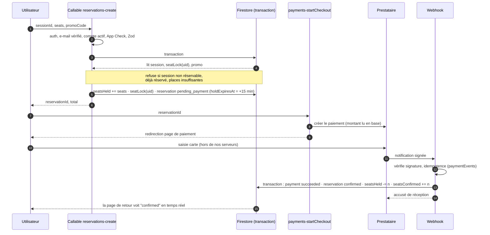

# 06 — Cloud Functions et logique métier

> Phase 1 · Document d'architecture · Statut : **en attente de validation**

Toutes les functions sont en **Cloud Functions v2**, TypeScript, Node.js 22, région `europe-west1` (D3). Les callables exigent App Check en production. La logique métier pure (prix, annulation, matching) vit dans `packages/shared` et `packages/matching` pour être testée unitairement sans Firebase.

## 1. Inventaire

### Callables utilisateur
| Function | Rôle |
|---|---|
| `reservations-create` | Bloque des places et crée une réservation `pending_payment` (ou `confirmed` si total = 0) |
| `reservations-quote` | Calcule le prix (code promo, frais) sans rien bloquer — affichage du récapitulatif |
| `payments-startCheckout` | Crée le paiement chez le prestataire, renvoie l'URL/le formulaire de redirection |
| `reservations-cancel` | Annule selon la politique, calcule et lance le remboursement, libère les places |
| `waitlist-join` / `waitlist-leave` | Liste d'attente d'une session complète |
| `waitlist-accept` | Accepte une place proposée (crée une réservation avec blocage) |
| `reviews-create` | Avis après l'expérience |
| `reports-create` | Signalement d'un participant |
| `account-exportData` / `account-requestDeletion` | Droits loi 09-08 |

### Callables admin
| Function | Rôle |
|---|---|
| `admin-sessions-create` / `admin-sessions-update` | Création de dates (unique ou récurrente), modification de capacité (≥ places prises), publication |
| `admin-sessions-cancel` | Annulation d'une session : rembourse tout le monde, notifie |
| `admin-reservations-cancel` / `admin-reservations-refund` | Annulation / remboursement manuel (total ou partiel), journalisé |
| `admin-reservations-move` | Déplace une réservation vers une autre date (transaction sur les deux sessions) |
| `admin-reservations-checkIn` | Pointage le jour J (`attended`) |
| `admin-groups-generate` | Lance l'algorithme de matching → groupes `proposed` |
| `admin-groups-update` | Déplacer un participant, fusionner, diviser, renommer |
| `admin-groups-validate` / `admin-groups-reveal` | Valide la composition ; révèle (immédiatement ou à `revealAt`) |
| `admin-exports-participants` | CSV / XLSX dans Storage + URL signée 15 min, journalisé |
| `admin-users-setRole` (superadmin) / `admin-users-suspend` | Gestion des comptes |

### HTTP (webhooks)
| Function | Rôle |
|---|---|
| `payments-webhook-{provider}` | Reçoit la notification du prestataire, vérifie la signature, confirme ou échoue le paiement |

### Planifiées
| Function | Fréquence | Rôle |
|---|---|---|
| `reservations-expireHolds` | toutes les 5 min | Expire les `pending_payment` dépassés, libère les places, propose à la liste d'attente |
| `payments-reconcile` | toutes les 15 min | Interroge le prestataire pour les paiements `initiated` anciens (webhook perdu) |
| `notifications-reminders` | toutes les heures | Rappels J-1 et H-3, demandes d'avis J+1 |
| `groups-autoReveal` | toutes les 15 min | Révèle les groupes validés dont `revealAt` est passé |
| `sessions-complete` | toutes les heures | Passe les sessions terminées en `completed`, `no_show` pour les non-pointés si check-in utilisé |
| `stats-aggregateDaily` | chaque nuit | Calcule `statsDaily` |
| `account-purgeDeleted` | chaque nuit | Exécute les suppressions/anonymisations demandées |

### Triggers
| Trigger | Rôle |
|---|---|
| Auth `beforeUserCreated` (blocking) | Pose le claim `role: "user"` dès la création |
| Auth `onCreate` → `users` | Crée le document profil, e-mail de bienvenue |
| `experiences` onWrite | Resynchronise `experienceSnapshot` des sessions futures, revalide les pages ISR |
| `sessions` onUpdate (date/lieu changés) | Notifie les participants confirmés |
| `reservations` onWrite | Notifications (confirmation, annulation), compteurs `users.stats` |
| `reviews` onCreate | Recalcule `ratingAvg` / `ratingCount` de l'expérience |
| Storage onFinalize | Redimensionne/convertit les images, retire l'EXIF |

## 2. Réservation : déroulé et garanties

**Garanties :**
1. **Pas de surréservation** : la vérification des places et l'incrément sont dans la même transaction Firestore. Test automatisé prévu : 50 réservations simultanées sur 12 places → exactement 12 réussissent.
2. **Pas de doublon** : le document `seatLocks/{uid}` est créé dans la transaction ; une seconde tentative échoue.
3. **Prix incontestable** : le montant est calculé et stocké par le serveur ; le webhook vérifie que le montant payé correspond.
4. **Paiement tardif** : si le webhook arrive après expiration du blocage, le serveur tente de reprendre une place ; s'il n'y en a plus, il rembourse automatiquement et notifie l'utilisateur. Aucun cas où l'utilisateur paie sans place ni remboursement.
5. **Webhook perdu** : la tâche `payments-reconcile` interroge le prestataire.

## 3. Annulation et remboursement

1. L'utilisateur voit le montant remboursable **avant** de confirmer (calcul via la politique d'annulation de l'expérience).
2. Transaction : réservation `cancelled`, libération des places (`seatsConfirmed -= n`), suppression du `seatLock`.
3. Remboursement lancé via l'adaptateur ; le statut `refunded` n'est posé qu'à la confirmation du prestataire.
4. Si une liste d'attente existe : la première personne reçoit une offre valable X heures (paramètre).
5. Si les groupes étaient déjà validés : alerte admin pour rééquilibrer.

**Politique par défaut proposée (hypothèse, D6) :** remboursement intégral jusqu'à 48 h avant ; aucun remboursement ensuite (possibilité de céder sa place plus tard). Annulation par la plateforme : remboursement intégral, toujours.

## 4. Liste d'attente

- Ouverte quand `status == full`. L'entrée est ordonnée par date d'inscription.
- Libération d'une place → offre à la première personne (`offered`, `offerExpiresAt`), notification e-mail/in-app/push.
- L'utilisateur accepte → réservation avec blocage habituel → paiement. Sinon, expiration et offre à la suivante.
- Pas de débit automatique au lancement (plus simple et plus sûr juridiquement).

## 5. Matching social (phase 6, version 1 à base de règles)

Module pur `packages/matching`, sans dépendance à Firebase, entièrement testé unitairement.

**Entrées :** liste des participants confirmés (tranche d'âge, langues, intérêts, envies sociales, genre si collecté, historique des co-participants, réservations liées « venus ensemble »), configuration de la session (`targetSize`, `minSize`, `maxSize`).

**1. Découpage en groupes** : nombre de groupes `k = round(n / targetSize)`, tailles réparties équitablement entre `minSize` et `maxSize` (ex. 31 personnes, cible 6 → 5 tables : 6, 6, 6, 6, 7).

**2. Contraintes fortes** (une solution qui les viole est rejetée si une alternative existe) :
- au moins une langue commune à tout le groupe ;
- les personnes qui ont réservé ensemble restent ensemble (option par expérience) ;
- taille dans les bornes.

**3. Score (plus haut = meilleur), pondérations paramétrables par l'admin :**

| Critère | Effet |
|---|---|
| Ressemblance d'âge | Pénalité si l'écart de tranche d'âge au sein du groupe est trop grand |
| Intérêts | Bonus pour 2–3 intérêts partagés, léger malus si tout le monde a exactement le même profil (diversité) |
| Envies sociales | Bonus pour des envies compatibles |
| Déjà rencontrés | Forte pénalité pour chaque paire déjà réunie dans les N derniers mois |
| Équilibre (genre, si collecté) | Pénalité si le groupe est fortement déséquilibré |
| Équité | Pénalité si un groupe a un score très inférieur aux autres (on maximise le minimum, pas seulement la moyenne) |

**4. Algorithme** : constitution initiale gloutonne (on place d'abord les profils les plus contraints), puis **amélioration locale par échanges** (on teste des permutations de 2 personnes entre groupes et on garde celles qui augmentent le score) pendant un nombre fixe d'itérations, avec une graine aléatoire enregistrée pour que le résultat soit reproductible. Pour 30 à 200 participants, le calcul prend moins d'une seconde.

**5. Sortie** : groupes `proposed` + pour chaque groupe le score détaillé et les alertes lisibles (« Karim et Lina ont déjà dîné ensemble le 12/10 »). L'admin ajuste par glisser-déposer (le score se recalcule en direct), puis valide et révèle.

**Évolutivité** : l'interface `MatchingStrategy` permettra de brancher une autre stratégie (pondérations apprises à partir des avis « ambiance du groupe ») sans toucher au reste.

## 6. Calcul financier

Pour chaque réservation confirmée, le serveur fige au moment du paiement :
- `gross` = total payé ;
- `commission` = selon le modèle de l'expérience (`own` : marge = prix − coût par place ; `commission` : pourcentage ou montant fixe reversé à la plateforme) ;
- `cost` = coût par place (modèle `own`) ou montant reversé au partenaire (modèle `commission`) ;
- `margin` = gross − cost − remises − frais du prestataire de paiement (estimés).

Ces valeurs sont stockées dans `reservations/{id}/private/finance` (admin) et agrégées chaque nuit dans `statsDaily`. Le tableau de bord lit les agrégats (rapide, peu coûteux) et les données du jour en direct.
