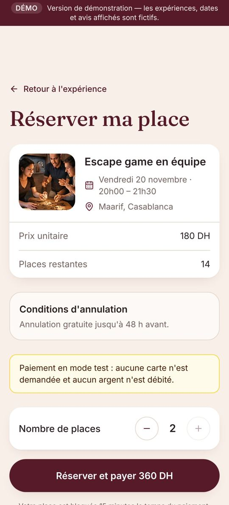
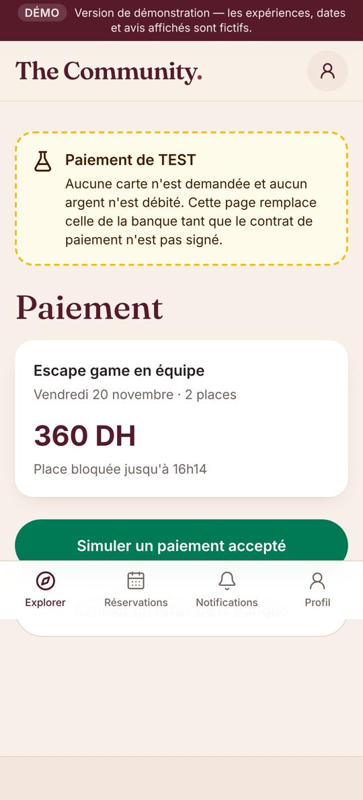
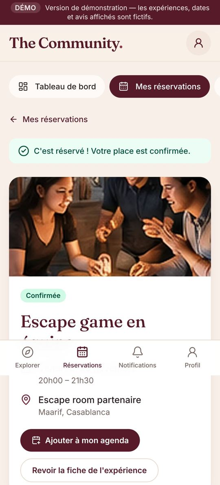
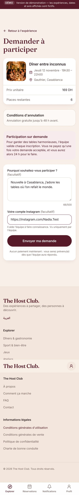
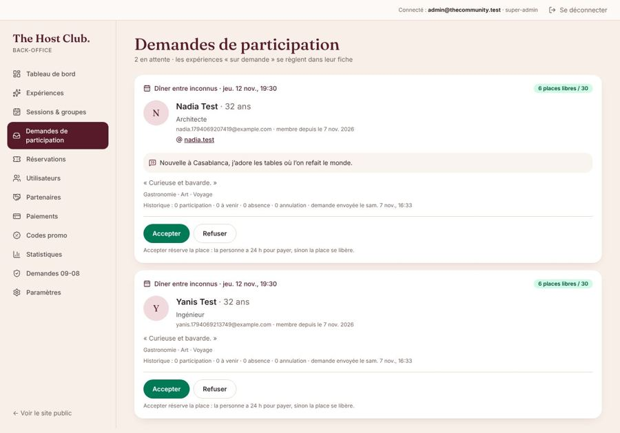
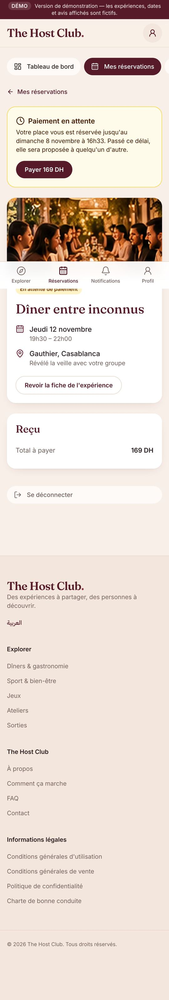
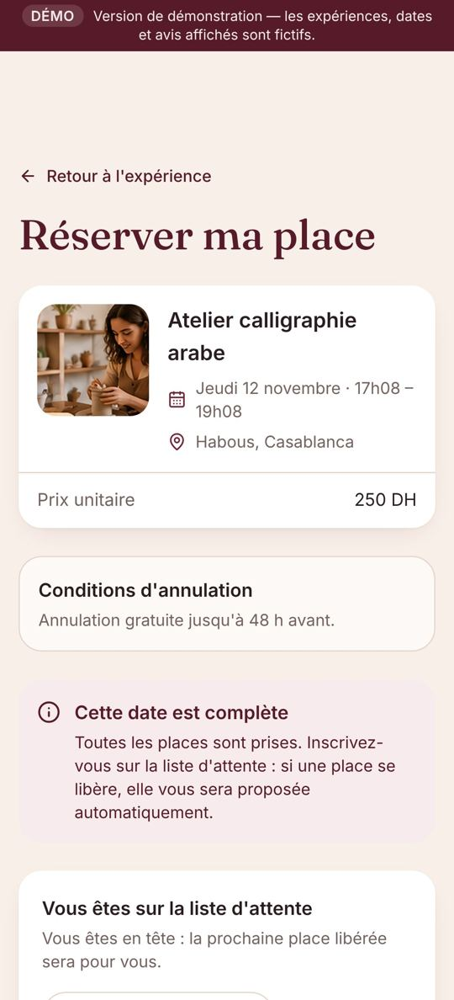
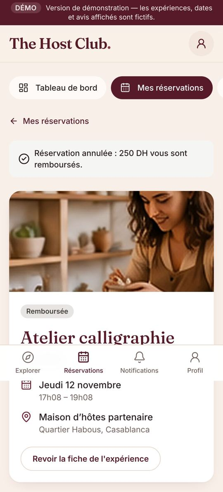
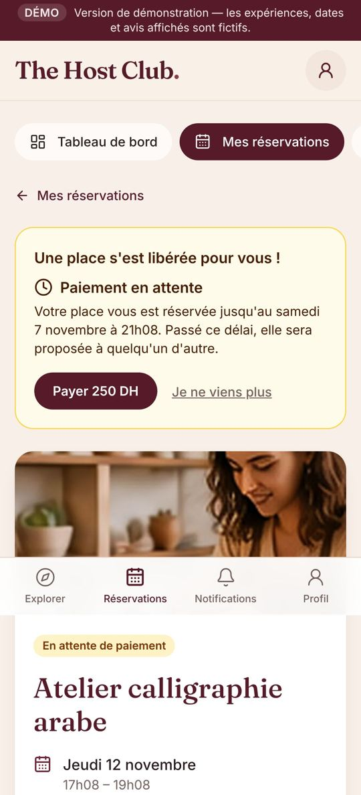

# 14 — Phase 4 : Réservations — avancement

> Objectif de la phase (docs/08) : réservation transactionnelle, blocage pendant le paiement, annulation,
> liste d'attente, historique, export. Livrable : **tests de concurrence verts** et **parcours complet avec l'adaptateur de paiement de test**.

| Étape | Contenu | Statut |
|---|---|---|
| **4a** | Réserver une place, la bloquer 15 min, payer (en test), confirmer ; expiration ; paiement tardif | ✅ |
| **4a+** | **Participation sur demande** : la personne demande, l'équipe accepte ou refuse, puis paiement sous 24 h | ✅ |
| **4b** | Annulation par le membre (politique 48 h, remboursement), liste d'attente avec offre automatique | ✅ |
| 4c | Back-office : réservations réelles, annulation/déplacement par l'équipe, pointage, export des participants | à venir |

## Étape 4a — Réserver et payer (en mode test) ✅

### Ce que voit un membre

1. Sur une date, **Réserver** → page récapitulative (prix, places restantes, conditions d'annulation).
   - Pas connecté : invitation à se connecter ou à créer un compte, puis retour automatique sur cette page.
   - E-mail pas encore confirmé, ou profil incomplet : explication et bouton pour régler ça.
   - Date complète, fermée (12 h avant un dîner, 2 h avant les autres formats) : message clair, pas de bouton.
2. Choix du nombre de places (si l'expérience l'autorise), puis **Réserver et payer**.
   La place est **bloquée 15 minutes** pour lui pendant le paiement.
3. Page de paiement. Tant que le contrat avec une banque n'est pas signé, c'est une **page de TEST**
   clairement signalée : aucune carte, aucun argent ; deux boutons simulent l'accord ou le refus de la banque.
4. Refus : la place reste bloquée, bouton **Payer** pour réessayer. Accord : **réservation confirmée**,
   lieu exact affiché (sauf dîners : révélé avec le groupe), ajout à l'agenda.

| Tunnel | Paiement de test | Confirmée |
|---|---|---|
|  |  |  |

### Garanties côté serveur

| Garantie | Comment |
|---|---|
| **Jamais plus de réservations que de places** | Vérification et blocage dans une même transaction Firestore |
| **Une seule réservation par personne et par date** | Verrou `sessions/{id}/seatLocks/{uid}` ; un double clic reprend la même réservation |
| **Prix incontestable** | Calculé et enregistré par le serveur ; le navigateur n'envoie que la date et le nombre de places |
| **Place libérée si on ne paie pas** | Tâche automatique toutes les 5 minutes (`expireHolds`) |
| **Paiement arrivé trop tard** | Place reprise s'il en reste ; sinon **remboursement automatique** et explication au membre |
| **Notification de paiement reçue deux fois** | Traitée une seule fois (journal `paymentEvents`) |
| **Montant payé différent** | Remboursé automatiquement, réservation inchangée |
| **Paiement de test impossible en production** | La page et la fonction de test ne marchent que si le réglage `settings/payment` vaut `{ provider: "sandbox", mode: "test" }` ; sans réglage, le paiement est désactivé |

Le vrai prestataire (CMI, Payzone, YouCan Pay…) sera un **adaptateur de plus** derrière la même interface (phase 5) :
le reste du code ne change pas.

### Tests

- **16 tests d'intégration** sur émulateurs (`firebase/tests/reservations.test.ts`), dont :
  - **50 réservations simultanées pour 12 places : exactement 12 réussissent**, les 38 autres reçoivent « complet » ;
  - 10 vrais clients en même temps pour 4 places ; 5 clics simultanés de la même personne → une seule réservation ;
  - paiement refusé puis accepté, expiration, paiement tardif avec et sans place, date gratuite, paiement désactivé.
- **6 tests unitaires** (prix, fermeture des réservations, raisons de refus).
- **22 vérifications de bout en bout** dans un vrai navigateur mobile (`tests/e2e/firebase-booking.e2e.cjs`) :
  visiteur → connexion → e-mail à confirmer → 2 places → paiement refusé → paiement accepté → confirmé dans Firestore → doublon refusé → version arabe.
- Tous les tests précédents repassent : 57 sur émulateurs, 33 unitaires, 73 de bout en bout en mode Firebase, 60 en mode démonstration.

### Fichiers principaux

| Rôle | Fichier |
|---|---|
| Règles communes (prix, délais, refus) | `packages/shared/src/booking.ts` |
| Réservation | `functions/src/reservations/create-reservation.ts` |
| Expiration des blocages | `functions/src/reservations/expire-holds.ts` |
| Interface prestataire + adaptateur de test | `functions/src/payments/provider.ts`, `providers/sandbox.ts` |
| Démarrage du paiement / réponse de test | `functions/src/payments/start-checkout.ts`, `sandbox-complete.ts` |
| Traitement d'un paiement (commun à tous les prestataires) | `functions/src/payments/apply-event.ts` |
| Tunnel, page de test, suivi | `apps/web/app/[locale]/reserver/…`, `paiement-test/…`, `espace/reservations/[id]` |

## Participation sur demande (ajout du 7 novembre 2026) ✅

Demandé par Rita : pouvoir **choisir les participants**. Décisions validées :
au choix **par expérience** ; **paiement après acceptation** (24 h pour payer) ; la demande contient un **message** (facultatif ou obligatoire selon l'expérience) et un **compte Instagram facultatif**.

### Pour l'équipe

1. Back-office → **Expériences** → la fiche → **Inscription : « Sur demande »** (et, si souhaité, « Message de motivation obligatoire ») → Enregistrer.
2. Les demandes arrivent dans **Demandes de participation** (menu du back-office ; un bandeau les signale sur le tableau de bord).
   Pour chaque personne : photo, âge, profession, bio, centres d'intérêt, Instagram, message, historique (participations, absences, annulations) et places encore libres sur la date.
3. **Accepter** : la place est réservée et la personne a **24 h pour payer** (sinon la place se libère automatiquement). **Refuser** : la personne est prévenue, sans détail.
   Impossible d'accepter plus de personnes que de places. Chaque décision est journalisée.

### Pour le membre

Sur la fiche, le bouton devient **« Demander à participer »**. Il envoie sa demande sans payer, la suit dans **Mes réservations**
(et peut la retirer tant qu'elle n'est pas traitée), reçoit une **notification** à la décision, puis paie depuis sa réservation.
Une demande refusée ne peut pas être renvoyée pour la même date.

| Demande | Back-office | Acceptée |
|---|---|---|
|  |  |  |

### Tests

- 7 tests d'intégration (`firebase/tests/reservations.test.ts`) : réservation directe refusée pour une expérience sur demande (et inversement),
  message obligatoire, Instagram vérifié, aucune place bloquée avant décision, acceptation → place bloquée 24 h → paiement → confirmé,
  notification et journal, refus, impossible d'accepter au-delà des places, retrait de la demande ; 1 test de règles de sécurité.
- 23 vérifications de bout en bout (`tests/e2e/firebase-requests.e2e.cjs`) : deux membres demandent, l'admin accepte l'une et refuse l'autre dans le back-office, paiement de test, refus affiché.

> Le compte Instagram est une donnée personnelle de plus : il est lisible uniquement par la personne et l'équipe, et devra figurer dans la politique de confidentialité (voir docs/11, section E).

## Étape 4b — Annulation et liste d'attente ✅

### Annuler

Dans **Mes réservations** → la réservation → **Annuler ma réservation**. Le montant remboursé est annoncé **avant** de confirmer :
100 % jusqu'à 48 h avant le début, rien ensuite (politique de l'expérience, recalculée par le serveur au moment de l'annulation).
Le remboursement passe par le prestataire (en test : immédiat) ; la réservation devient **Remboursée**.
Une réservation pas encore payée peut être libérée (« Je ne viens plus »). Impossible d'annuler une fois l'expérience commencée.

### Liste d'attente

- Sur une date **complète**, le membre voit **Rejoindre la liste d'attente** (aucun paiement), puis sa **position**. Il peut la quitter à tout moment.
- Dès qu'une place se libère (annulation, ou paiement non fait à temps), elle est **proposée automatiquement à la première personne** de la liste,
  dans la même opération : la place lui est **réservée 4 h** (jamais au-delà de la fermeture des réservations), elle reçoit une notification et paie depuis sa réservation.
  Personne d'autre ne peut prendre cette place entre-temps.
- Pas payé à temps → la place passe à la suivante. Une demande de 2 places quand 1 seule se libère est sautée, pas perdue.
- Pour les expériences **sur demande**, la liste d'attente n'existe pas : la demande joue ce rôle.

| Sur la liste | Annulation remboursée | Place proposée |
|---|---|---|
|  |  |  |

### Tests

- 9 tests d'intégration : remboursement intégral à plus de 48 h, aucun à moins de 48 h, abandon d'une réservation non payée, refus pour autrui et après le début ;
  inscription seulement si complet, une seule fois, départ ; offre à la première personne (4 h, notification, place inaccessible aux autres),
  passage à la suivante après expiration, demande trop grande sautée, offre après un blocage expiré.
- 16 vérifications de bout en bout (`tests/e2e/firebase-cancel-waitlist.e2e.cjs`) : A prend la dernière place, B rejoint la liste, A annule (remboursé), B est prévenu et paie.
- Toutes les suites repassent : 72 tests sur émulateurs, 35 unitaires, 113 vérifications de bout en bout en mode Firebase, 60 en démonstration.

> Hypothèse retenue (modifiable) : **4 h** pour payer une place proposée depuis la liste d'attente.

### Reste pour la suite de la phase 4

- Back-office branché sur les vraies réservations : liste, annulation, déplacement, pointage, export (4c).
- E-mails de confirmation : phase 7 (pour l'instant, la confirmation s'affiche sur le site et dans « Mes réservations »).
- Codes promo et frais de service : phase 5.
