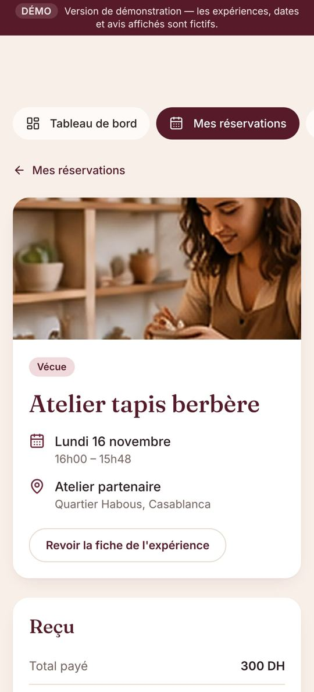
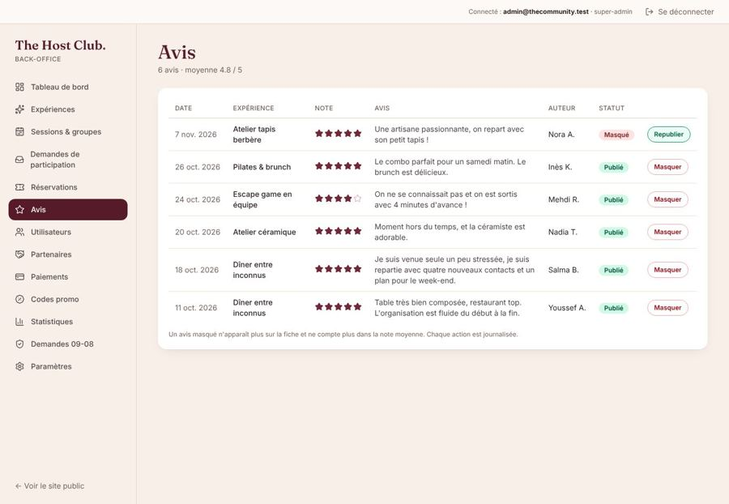
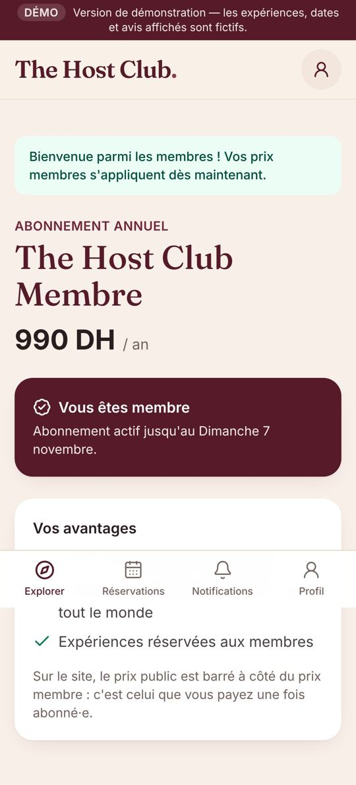
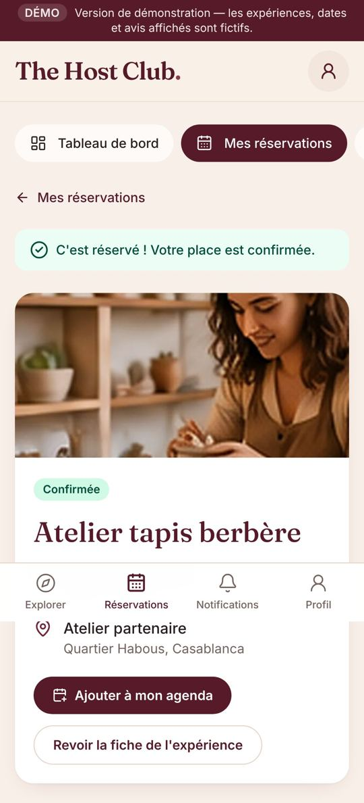
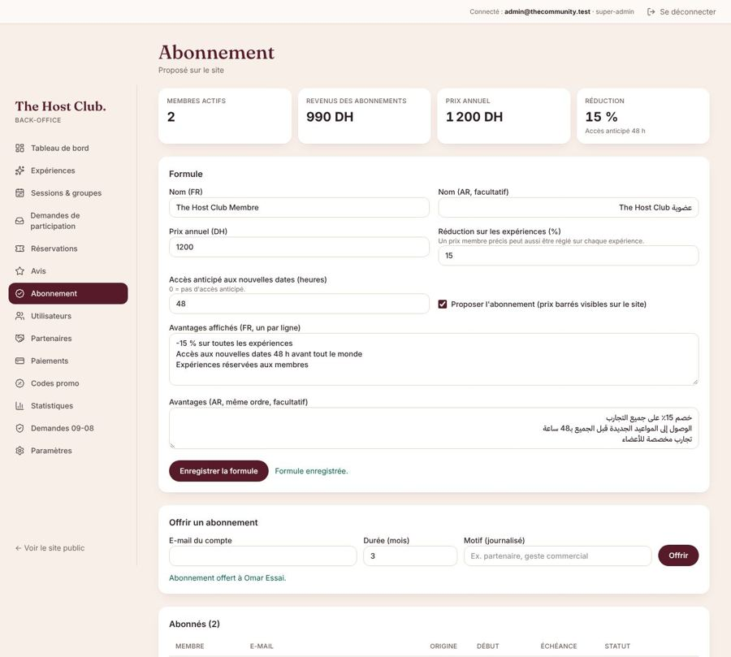

# 15 — Feuille de route après la phase 4

> Demandes de Rita du 7 novembre 2026, intégrées au plan. Chaque étape se termine par une démonstration et sa validation.
> Les choix marqués **(hypothèse)** sont des propositions : on les change facilement si besoin.

> **Règle de travail (8 novembre)** : chaque nouvelle demande est d'abord **ajoutée à ce plan**, puis réalisée **étape par étape**, sur « go » de Rita. On ne lance pas une demande dès qu'elle arrive.

## Fait

| Étape | Contenu |
|---|---|
| 1 à 4c ✅ | Site, comptes, back-office, réservations, paiement de test, demandes de participation, annulations, liste d'attente |
| 5a ✅ | Avis, fiches sans date, expériences passées listées, reproposer des dates |
| 5b ✅ | Abonnement annuel (prix membre, prix public barré, accès anticipé, réservé aux membres) |
| 5c ✅ | Factures, avoirs et reçus PDF, e-mails (boîte d'envoi de test) |
| Contenus ✅ | FAQ, centre d'aide, Devenir partenaire, version anglaise, Sécurité / CGU / CGV / Confidentialité, À propos (Aya, avec sa photo) |
| 5d ✅ | Partenaires dans le back-office : ajouter, modifier, archiver / réactiver, supprimer (super-admin, jamais un partenaire utilisé), candidature → partenaire, filtre « Archivés » |
| 5e ✅ | Paramètres : villes (ajouter, renommer fr / ar / en, ouvrir ou « bientôt », quartiers) et univers (noms, description, ordre, visibilité, mode par défaut), super-admin, journalisé |
| Accueil ✅ | Vraie photo fournie par Rita (8 novembre) |
| 5f ✅ | **Codes promo** (back-office : créer, modifier, désactiver ; % ou montant, période, plafond, première réservation ; une fois par personne, comptés au paiement) et **frais de service** (Paramètres : aucun, par place ou % ; affichés avant le paiement, jamais sur une place gratuite, remboursés avec la place). Prix détaillé au tunnel, sur la réservation et sur la facture |
| 5g ✅ | **Régime, allergies, langue(s) de table** à la réservation et sur les demandes (reprises à l'acceptation), modifiables jusqu'au début ; accord explicite et daté pour transmettre au lieu ; colonne « Accueil » des participants, export CSV, **fiche pour le lieu** imprimable (prénoms pour les marque-places, régimes, allergies, sans coordonnées) |
| 6 ✅ | **Composition des tables** : algorithme (taille, langue commune, pas de personnes déjà attablées ensemble, âges, équilibre F / H, intérêts ; réservations à plusieurs places gardées ensemble) → corrections à la main → enregistrement → **révélation** (table, prénoms et intérêts du groupe, lieu s'il était gardé secret, notification + e-mail) ; alerte « à revoir » si une réservation change ; **fiche hôte** (hôte, déroulé, 10 questions pour briser la glace, **marque-places** par table, imprimable) ; **plafond de 50 places** par date |
| 7 ✅ | **Rappels** la veille et 3 h avant (notification + e-mail, une seule fois, e-mails désactivables dans les préférences) ; **changement de date ou de lieu** : notification + e-mail ; **statistiques** par période (à venir, 30 j, 90 j, depuis le début) : CA, marge, remplissage, fidélité, note moyenne, annulations, absences, codes promo, par univers et par mois. Notifications push : en attente de la clé Web Push (docs/16) |
| 8a ✅ | **Accueil** : accroche « Your people are out there. » + « Sortez de votre routine… », « Comment ça marche » en cartes décalées (icônes des univers, bouton vers les expériences, 3 photos du groupe), **5 univers en alternance photo / texte** avec bouton « Découvrir », **« Pourquoi venir »** (grande photo + avis par-dessus, défilables), **FAQ** sous « Bientôt dans d'autres villes » puis « Vous avez d'autres questions ? » → centre d'aide |
| 8b ✅ | **Menu (ordinateur)** : Découvrir (déroulant : toutes les expériences, Dîners, Sport & bien-être, Jeux, Ateliers, Sorties ; souris, clic ou clavier), À propos, Comment ça marche, Blog. Sur mobile : barre du bas inchangée, Blog et À propos dans le pied de page |
| 8c ✅ | **Blog** « Inconnus aujourd'hui, amis demain » (EN : *Strangers Today, Friends Tomorrow* ; AR : غرباء اليوم، أصدقاء الغد) : 4 onglets — **City guide** (3 articles Casablanca + FAQ), **Conversation** (5), **Amitié** (4), **Comment fonctionne The Host Club** (7) — 19 articles rédigés par nous en FR + EN (arabe : version française affichée avec une mention, à traduire), articles liés, appel vers les expériences, référencement (titre, description, URL canonique, données structurées, plan du site) |
| 8d ✅ | **Sécurité enrichie** : ce que nous faisons, avant (prévenir un proche, prévoir le retour, besoins particuliers, payer uniquement sur le site), pendant (tout est facultatif, verre et affaires en vue, allergies à confirmer au personnel), sorties en plein air, urgence (19, 177, 15, 112 depuis un portable), après (ne jamais envoyer d'argent, rentrer en sécurité) |
| 8f ✅ | **Règles de la communauté** (`/charte`, page dédiée) : où elles s'appliquent, compte, venir ou annuler, vie privée des autres, lignes rouges (exclusion immédiate), discrimination, harcèlement, usage loyal, sujets difficiles, lieux, signalements, mesures graduées, recours sous 7 jours ; reliées depuis Sécurité, CGU, inscription, pied de page, centre d'aide et blog |
| 8g ✅ | **CGU revues** : ce que nous faisons / ce que fait le lieu (régime transmis, allergies à vérifier sur place, inclus / à vos frais, changement de lieu), ce que nous ne pouvons pas garantir, conditions pour s'inscrire, interdits, photos et vidéos **seulement avec accord**, sanctions notifiées et **recours sous 7 jours**, loi 31-08 |
| Menu mobile ✅ | **Menu burger** (validé par Rita) : barre flottante (logo, « S'inscrire » ou icône compte, burger) ; carte qui s'ouvre avec Découvrir ⌄, À propos, Comment ça marche, Blog, Villes ⌄, Se connecter / S'inscrire (ou Mon compte / Se déconnecter), langues ; Échap, focus gardé, page bloquée derrière ; barre du bas des membres conservée |
| 8i ✅ | **Blog, nouvelle mise en page** (mobile d'abord) : accroche avec la fin en couleur, thèmes en pastilles défilantes, article **« Commencer ici »** mis en avant, **« Les plus lus »** (liste compacte avec vignettes ; notre sélection tant que les lectures ne sont pas mesurées), **« Parcourir les articles »** avec tri Plus lus / Récents et **recherche sans accents** ; pages de thème (fil d'Ariane, « N articles · mis à jour le… », carte **« Rencontrer du monde à Casablanca »** avec « Trouver mon groupe » / « Choisir une autre ville », FAQ City guide, bloc **« Utile aussi »**) ; « À lire aussi » en bas des articles |
| 8h ✅ | **Confidentialité revue** : comment les données sont recueillies, **tableau finalité / base légale / durée** (régime et allergies avec accord explicite, effacés 30 jours après l'expérience ; photos avec accord ; pièces comptables 10 ans), **liste des prestataires** (Google Cloud / Firebase, Brevo, prestataire de paiement à venir), transferts hors du Maroc, droits avec réponse sous un mois, **mineurs et protection de l'enfance** ; tableaux affichés en fiches sur mobile |
| 8e ✅ | **Page À propos** : en-tête (« Des inconnus à table. *Des amis en repartant.* » + grande photo), **la créatrice** (photo à gauche, texte à droite, Instagram), **ce qui compte pour elle**, **« Nos outils pour créer du lien »** en cartes numérotées qui défilent (flèche « suivant » seule au départ, puis les deux sens ; 8 outils réels du site), **galerie** « Des rencontres qui valent mille images » (8 photos, en mosaïque) |
| 5i ✅ | **Archiver / supprimer une expérience** (back-office, fiche de l'expérience) : **Archiver** (équipe) → disparaît du site, fiche publique « Cette expérience n'est plus proposée » (non référencée, expériences du même univers proposées), historique conservé ; refusé tant qu'une date à venir a des participants, une liste d'attente ou une demande en attente ; dates vides repassées en brouillon ; filtre « Archivées », bouton **Réactiver** (en brouillon) ; une expérience archivée le reste même si on enregistre sa fiche. **Supprimer définitivement** (super-admin) → seulement sans aucun historique (réservation, demande, avis) ; efface dates, données internes, alertes et photos. Confirmation avant chaque action, journalisé |
| Arabe ✅ | **Pages encore en français traduites en arabe** (8 novembre) : textes juridiques (Sécurité, Règles de la communauté, CGU, CGV, Confidentialité), **centre d'aide** (7 catégories, 23 articles), **blog** (4 thèmes, 19 articles, FAQ City guide) ; plus de mention « traduction à venir ». Back-office : **accroche et description en arabe** pour chaque expérience (bloc « Version arabe », ouvert par défaut) |
| 5j ✅ | **Ordre des listes de l'espace membre** : annulées de la plus récente à la plus ancienne ; demandes et listes d'attente par date de l'expérience (la plus proche d'abord) ; favoris : date à venir (avec la date), puis sans date, puis **archivées en dernier** (« N'est plus proposée », grisées) |
| 10 ✅ | **Identité de marque** (docs/18) : ton & ambiance, typographie, couleurs ; logotype redessiné ; monogramme **« h. »** ; motif **« le fil »** ; papeterie, accueil des tables, affichage, objets ; **brand book version 1** (`docs/marque/brand-book.html`, fichiers SVG dans `docs/marque/`) |
| 10f ✅ | **Identité sur le site** : logo vectoriel (en-tête, menu mobile, pied de page, back-office) ; icônes « h. » (onglet, application, manifeste) ; image de partage 1200×630 ; motif « le fil » sur le bandeau des villes et l'appel du blog ; fiche hôte : marque-places au monogramme, **numéros de table**, **cartes de bienvenue** (3 questions par table) ; **chevalet « Réservé » avec QR** par partenaire ; **e-mails** avec bandeau prune, logo et motif ; **factures PDF** avec le logo vectoriel. Reste en option : page « Kit presse » |
| 11 ✅ | **Tarification en deux parts** (détail docs/19, § 8) : formulaire — section 5 « Tarification et paiement client » (tout en ligne / prix fixe sur place / consommation sur place), aperçu client en direct, avertissement « prix figé » ; fiche, cartes, tunnel, réservation : « 139 DH par personne · 59 DH maintenant · 80 DH sur place » ou « 120 DH + consommation » ; e-mail, facture (« hors facture », jamais encaissé) et CGV (FR / EN / AR) ; **billet avec QR code** ; page équipe **Billets** (scan avec l'appareil photo, code court, présence, part partenaire réglée) ; tableau de bord **En ligne / sur place** (filtres expérience, organisateur, période ; export CSV) |
| 5h phase 1 ✅ (sans RIB) | **Paiement par virement bancaire** (détail docs/19, § 9) : référence unique THC-XXXXXX, instructions à l'écran et par e-mail, place bloquée jusqu'à l'échéance (48 h, au plus tard 24 h avant ; réservation par virement fermée si la date est trop proche), page équipe **Virements** (« Virement reçu » → confirmation, billet, facture ; remboursements faits à la main → « Remboursement effectué » → avoir), e-mail si la place est libérée faute de virement, réglage **Mode de paiement** (super-admin) — **reste à faire par Rita : saisir le RIB** dans Paramètres une fois le compte pro ouvert (le site reste en paiement de test d'ici là) |
| Kit presse ✅ | **Page « Presse »** (`/presse`, lien dans le pied de page, FR / EN / AR) : présentation en 3 longueurs avec bouton « Copier », faits clés (sans chiffre inventé), fondatrice, **6 logos en SVG et PNG** (horizontal prune / crème / encre, empilé prune / crème, monogramme) avec règles d'usage, couleurs (HEX), typographies, **2 photos sans personne reconnaissable** (les autres sur demande, après accord des participants), contact presse (formulaire) |
| 11g ✅ | **Formulaire : une seule section « 4. Prix, paiement et partenaire »** (au lieu de « Partenaire et économie » + « Tarification et paiement client ») : partenaire → mode de paiement du client → bloc « Payé en ligne » (prix, prix membre, ce qu'il comprend — remplace « Ce qui est inclus ») → bloc « Payé sur place » (prix, ce qu'il comprend) → « Ce que ça nous rapporte » (équipe) adapté au mode : la part sur place n'est **jamais un coût**, nos coûts deviennent facultatifs, commission éventuelle sur la part sur place facturée au partenaire ; avertissement si coût = prix sur place ; aperçus client et équipe côte à côte. Dates → 5, photos → 6. Données rétrocompatibles |
| 11h ✅ | **Retours du 8 novembre** : (1) un seul champ **« Ce qui est inclus »**, revenu dans « 3. Format », pour tout le prix (en ligne + sur place) — l'ancien « ce que comprend la part sur place » est repris dans la liste à la prochaine modification ; (2) expériences sur demande : case **« Compte Instagram obligatoire »** (comme le message de motivation), vérifiée par le serveur ; (3) la phrase « Les réductions… s'appliquent uniquement à la part payée en ligne » **n'est plus affichée aux clients** (fiche et réservation ; elle reste dans les CGV et le back-office) |
| 13 ✅ | **Pastille de notifications non lues** : nombre en direct sur l'onglet « Notifications » de la barre du bas et sur l'icône du compte (ordinateur), « 9+ » au-delà de 9, annoncé aux lecteurs d'écran (« Notifications, 1 non lue »), effacé dès la lecture. Les notifications sur le téléphone site fermé attendent la clé Web Push (docs/16) |
| A ✅ | **Effacement automatique** du régime, des allergies et des langues de table **30 jours après l'expérience** (chaque nuit à 3 h 30), dans les réservations et les demandes de participation, comme le promet la Politique de confidentialité |
| B ✅ | **Rappel par e-mail ~12 h avant l'échéance d'un virement** (une seule fois ; rien si le virement est déjà validé ou la réservation annulée) |
| C ✅ | **Page Abonnement** : « En attente de votre virement » avec la référence, le montant, l'échéance et le lien vers les coordonnées bancaires ; pas de second achat pendant l'attente |
| D ✅ | **Revue de sécurité** : formulaires de contact et de candidature passés par le serveur (format vérifié, 5 envois par heure et 20 par jour par appareil, piège à robots, plus aucune écriture directe en base) ; en-têtes de sécurité sur tout le site (pas d'affichage dans un cadre, HTTPS imposé, caméra / micro / position refusés) ; **App Check prêt**, activé dès la clé reCAPTCHA (docs/16). Règles Firestore et Storage relues : rien d'autre à corriger |
| E ✅ (droits à donner) | **Sauvegarde complète chaque nuit** (2 h 45), gardée 14 jours dans un dossier privé ; **bilan de santé chaque matin** (8 h 10) : sauvegarde, e-mails en échec, virements en retard → carte « Santé du site » sur le tableau de bord et **e-mail aux super-admins** en cas de problème. La sauvegarde a besoin de deux droits sur le compte de service (docs/16) |
| 12 ✅ | **Page « Comment ça marche »** présentée comme la section de l'accueil (trois cartes décalées : univers, bouton vers les expériences, photos), puis les formats et la sécurité (bandeau au motif « le fil ») |
| 12b ✅ | **« Les formats » sur « Comment ça marche »** affichés comme « Cinq univers pour sortir de sa routine » sur l'accueil (photo et texte en alternance, icône, bouton « Découvrir ») — même composant que l'accueil |
| 14 ✅ | **Les 19 articles du blog réécrits en français, anglais et arabe** (12 novembre) : un encadré **« L'essentiel »** en tête de chaque article ; des études réelles citées (Arthur Aron 1997, Jeffrey Hall 2018, Boothby et al. 2018) et le rapport de l'**OMS** de juin 2025 avec un lien vers la source, ouvert dans un nouvel onglet (chiffres repris d'une recherche web, le site de l'OMS n'étant pas joignable depuis l'environnement de travail : à relire) ; les articles « Comment fonctionne The Host Club » décrivent le site tel qu'il est aujourd'hui (virement avec référence THC-, billet QR, rappels la veille et 3 h avant, pastille de notifications, demande avec Instagram et 24 h pour payer, annulation remboursée à plus de 48 h, allergies effacées après 30 jours) ; la promesse « dire si vous aimeriez recroiser vos voisins de table » est **retirée** (pas encore construite) ; plus de photo CULTIQ en couverture ; **durée de lecture calculée** sur le texte (2 à 3 min, au lieu de 4 à 8 annoncées) ; accord arabe « دقيقتا قراءة » ; même structure et mêmes liens vérifiés dans les 3 langues |
| 15 ✅ | **Barre de réservation mobile de la fiche expérience** (retour du 12 novembre) : le bouton « Demander à participer » ne passe plus sur deux lignes (hauteur fixe, texte sur une ligne) ; barre et menu du bas opaques et collés (plus de texte de la page visible entre les deux) ; sous 360 px, le bouton passe sous le prix, en pleine largeur ; en-tête mobile resserré sous 380 px (logo et « S'inscrire » ne débordent plus) ; le bas du pied de page n'est plus caché par la barre. Vérifié en FR / AR / EN à 320, 360 et 390 px (tests automatiques ajoutés) |
| 16 (à choisir) | **Nouveau style complet du site et de l'univers** (demande du 12 novembre) : 4 pistes proposées sur une planche (A « Soleil d'Atlantique », B « Casa Déco », C « Bonne compagnie », D « Carnet »), lien : https://claude.ai/artifact/ThA9qgNct8bRWXLWr2WoFM. **Rien n'est appliqué au site.** Une fois la piste choisie : (1) déclinaison (logo, monogramme, motif, couleurs des 5 univers) ; (2) application au site, couleurs, polices, boutons, cartes, en FR / AR / EN, avec captures avant / après ; (3) e-mails, factures PDF, image de partage, icônes ; (4) nouvelle version du brand book (remplace les choix 10a–10f : prune / crème, « h. », « le fil »). Supports imprimés à refaire seulement s'ils ont été commandés | choix de Rita |
| 17 → 18 | **Positionnement « toutes les activités », pas seulement les dîners** (précision de Rita, 19 novembre : padel, paintball, ateliers, etc.). (1) Fiche expérience : nouveaux champs facultatifs **niveau** (débutant / intermédiaire / confirmé / tous niveaux), **matériel fourni / à apporter**, **tenue conseillée**, **âge minimum** (au-delà de 18 ans), **plein air** (annulation ou report en cas de météo défavorable) ; le niveau compte dans la composition des équipes (padel : 4 par terrain, de même niveau). (2) Groupes : « équipes » (paintball, quiz, padel) et « tables » (dîners) déjà gérés par l'outil de composition ; vérifier les tailles (2 à 50). (3) Le site met en avant la variété : l'article « Commencer ici » devient le guide complet (au lieu du dîner) ; des exemples padel et paintball en démonstration ; maquettes de style avec d'autres activités que le dîner. (4) Univers : paintball dans « Jeux » ou un nouvel univers « Sensations / plein air » (modifiable par Rita dans le back-office, sans code). (5) Sécurité : règles propres aux activités physiques (décharge de responsabilité à faire valider par l'avocat, assurance du lieu partenaire) | avocat pour la décharge |
| 18 ✅ (19 novembre) | **Toutes les activités** : (a) **questionnaire de 10 questions au plus** défini par l'équipe pour chaque expérience (modèles : niveau padel, allure course, personnalité dîner…), rempli par le membre après sa réservation, pris en compte par l'outil de composition des groupes (calcul fait chez nous, aucune donnée envoyée à un service d'IA externe) ; réponses effacées 30 jours après l'expérience ; (b) champs facultatifs de la fiche : niveau, matériel fourni, à apporter, tenue, âge minimum (vérifié au serveur), plein air avec règle météo ; (c) activités physiques : conditions de participation à accepter (projet, à faire relire par un avocat), assurance du lieu partenaire suivie dans le back-office (alerte si absente ou expirée) ; (d) **membres de confiance** qui proposent des sorties, validées par l'équipe avant publication (rémunération des membres organisateurs : non prévue pour l'instant) ; (e) variété : « Commencer ici » = guide complet, démo padel et paintball, nouveaux articles et questions fréquentes ; (f) CGV, CGU, charte, confidentialité, sécurité et aide mises à jour ; **livré et testé** : 143 tests émulateurs (11 nouveaux), 88 unitaires, démo (blog 177, aide 32, back-office 58, espace membre 30, presse 37), nouveau parcours Firebase « activités » (22 vérifications). Démo : padel et paintball (illustrations en attendant de vraies photos). Reste pour Rita : docs/16 (avocat, attestations d'assurance, photos) |
| 19 → 27 (19 à 24 : « go » du 20 novembre ; 25 à 27 : à venir) | **Nouveau cahier des charges « marketplace »** (20 novembre) : analyse complète dans **docs/20** (ce qu'on a, à améliorer, à ajouter), 7 points à trancher, et 9 étapes : 19 fondations (organisateurs, rôles cloisonnés, catégories dynamiques) · 20 espace organisateur · 21 commissions et comptabilité · 22 réservation / annulation / remboursement · 23 catalogue et recherche · 24 avis · 25 paiement réel, e-mails, push, analytics · 26 pilotage admin · 27 production. La direction artistique ne change pas | décisions de Rita (docs/20) |
| 19 ✅ (20 novembre) | **Fondations marketplace** : (a) **catégories dynamiques** — le super-admin crée des catégories et des sous-catégories (un niveau) dans Paramètres → Catégories : nom, description, pictogramme (liste fermée de 14), couleur, image, ordre, visibilité ; les cinq univers d'origine gardent leurs adresses (/casablanca/eat…) ; une sous-catégorie a sa page (/casablanca/padel) et se choisit sur la fiche de l'expérience ; menu, accueil, puces, plan du site, formulaire « Proposer une sortie » et back-office lisent la base (plus de liste écrite dans le code) ; démo : « Rencontres & activités sociales » et « Culture & apprentissage » **préparées mais masquées** (à rendre visibles quand des activités existent), « Padel » sous-catégorie de Sport ; (b) **villes enrichies** : région, pays, photo ; (c) **organisateurs** : modèle de données (profil public + détails privés), rôle « organisateur » lié à une structure (ne se donne plus à la main dans Utilisateurs), organisateur recopié sur chaque date, réservation et demande ; **règles d'accès cloisonnées** : un organisateur ne lit que ses activités, dates, réservations et demandes, jamais celles de The Host Club ni d'un autre organisateur, ni les profils clients, paiements ou journal ; aucune écriture directe ; pièces justificatives privées. **Testé** : 153 tests émulateurs (10 nouveaux, dont 7 d'isolement), 97 unitaires (9 nouveaux), démo (accueil/blog 183, back-office 63, aide 32, espace membre 30, presse 37), Firebase 18/18 (dont création de catégorie et de sous-catégorie de bout en bout) | — |
| 20 ✅ (20 novembre) | **Espace organisateur `/pro`** (français, comme le back-office ; lien « Espace organisateur » en pied de page) : (a) **inscription** : structure, contact, catégories (1 à 3), présentation, **pièces justificatives** (registre de commerce, assurance… PDF ou image, 10 Mo, 5 au plus, dossier privé), logo, **contrat organisateur accepté** (version et date enregistrées) ; (b) **back-office « Organisateurs »** : liste (demandes d'abord), fiche avec pièces (ouvertes par l'équipe seulement), historique, décisions **valider / demander un complément / refuser / suspendre / réactiver** (message obligatoire sauf pour valider, transmis par notification et e-mail) ; validation = droits d'organisateur ; suspension = droits retirés tout de suite ; (c) **activités** : même formulaire que l'équipe sans modèle économique, lieux partenaires ni avantages membres ; « Envoyer pour validation » → l'équipe **publie ou refuse avec un message** (filtre « À valider », alerte sur le tableau de bord) ; une activité déjà en ligne modifiée par l'organisateur reste en ligne, signalée « Modifiée » à l'équipe ; (d) **tableau de bord** (réservations payées, montant du mois, remplissage, taux d'annulation, à faire), **Dates** (à venir / passées), **Participants** (prénom + initiale, régime et allergies si la personne l'accepte, **pointage**, export journalisé, **annulation de la date** avec remboursement intégral), **Réservations** (filtres activité / statut / période, export CSV), **Demandes** (accepter / refuser), **Billets** (code ou QR code), **Profil public** ; (e) QR code des billets → `/billet/…` qui ouvre la bonne fiche (équipe, organisateur de l'activité ou participant) ; (f) **contrat organisateur** et **conditions de vente des activités des organisateurs** (FR / EN / AR, projets à faire relire). **Hypothèses** : un organisateur ne voit que le prénom et l'initiale du nom des participants ; les nouvelles dates d'une activité déjà en ligne sont publiées tout de suite ; la page publique de l'organisateur arrive à l'étape 23 et ses finances à l'étape 21. **Testé** : 159 tests émulateurs (16 nouveaux), 97 unitaires, démo (/pro 71, accueil/blog 183, back-office 63, aide 32, espace membre 30, presse 37), nouveau parcours Firebase « organisateurs » (29 vérifications, de l'inscription à la réservation vue par l'organisateur) | relecture avocat (contrat, conditions) |
| 21 ✅ (20 novembre) | **Commissions et comptabilité** : (a) **règles de commission** (super-admin, Back-office → Commissions) : générale, par catégorie, par organisateur ou par activité, pourcentage + montant fixe par place facultatif, **date d'effet** ; la plus précise l'emporte ; une règle ne se modifie pas (on en crée une nouvelle, l'ancienne se désactive) ; sans règle : 15 % (hypothèse) ; (b) **taux copié sur chaque réservation** d'activité d'organisateur au moment de la réservation (base : payé en ligne hors frais de service) ; (c) **registre des commissions** : une écriture « vente » au paiement, une écriture « remboursement » (négative, commission rendue au prorata) à chaque remboursement ; (d) **reversements** (Back-office → Reversements) : volume, commissions, remboursements, à reverser, déjà reversé ; « Préparer le reversement » regroupe les écritures dues dont l'activité est passée (refusé sans RIB ou si le solde n'est pas positif), « Virement effectué » avec la référence bancaire → l'organisateur est prévenu ; (e) **organisateur → Finances** : payé en ligne, commission, à recevoir, déjà reçu, son taux, détail par réservation, reversements, **RIB professionnel** (24 chiffres, jamais réaffiché en entier) ; (f) marge du tableau de bord = commission pour les activités d'organisateurs ; règles d'accès : registre et reversements lus par l'organisateur concerné seulement. **Testé** : 163 tests émulateurs (4 nouveaux), 103 unitaires (6 nouveaux), démo (/pro 87, back-office 63…), parcours Firebase organisateurs (finances, RIB, règle créée) | contrat CMI (encaissement pour compte de tiers), expert-comptable |
| 21b ✅ (20 novembre) | **Expériences inventées pour toutes les catégories** (démonstration, `isDemo`) : 14 nouvelles — Dîners : couscous du vendredi, thés & pâtisseries ; Sport : running club de la Corniche, randonnée à Bouskoura ; Jeux : soirée jeux de société, karaoké ; Ateliers : peinture sur zellige, parfum ; Sorties : balade street art, soirée gnaoua ; **Rencontres** : échange de langues, apéro des nouveaux arrivants ; **Culture** : visite Art déco, café de spécialité — avec dates, prix, avis, versions anglaise et arabe des titres, et **illustrations sans personnes** (à remplacer par de vraies photos) ; « Rencontres & activités sociales » et « Culture & apprentissage » **rendues visibles** (7 univers sur l'accueil et dans le menu). **Correction du déploiement** : le site d'essai ne recevait les expériences de démonstration que si la base était vide (padel et paintball n'y étaient donc pas) et **réécrivait catégories, villes et réglages à chaque déploiement** (renommages, frais de service, annulation faits dans le back-office écrasés) → désormais : réglages créés seulement s'ils manquent, catégories et villes modifiées dans le back-office jamais touchées, expériences de démonstration manquantes ajoutées **une seule fois**, jamais recréées si l'équipe les a supprimées. Pour retirer une expérience inventée : Back-office → Expériences → la fiche → Archiver ou Supprimer. **Testé** : démo (accueil/blog 195, back-office 63, /pro 87, espace membre 30), script de déploiement sur émulateur (2 passages, modifications de l'équipe conservées), Firebase 18/18 | — |
| 22 ✅ (20 novembre) | **Modes de paiement, politiques d'annulation, remboursements** : (a) **trois modes de paiement** pour les activités d'organisateurs, choisis dans le formulaire de l'activité : **A — tout en ligne** (le participant paie tout sur le site), **B — acompte** (10 à 90 % en ligne, le reste sur place à l'organisateur), **C — frais de réservation** (seule la commission est payée en ligne, au moins 1 DH, le reste sur place) ; l'organisateur saisit le **prix total par place** et voit en direct la part en ligne, la part sur place et la commission ; la commission est calculée **sur le prix total** pour B et C ; le super-admin choisit les modes proposés (Paramètres → Modes de paiement des organisateurs) ; (b) **politiques d'annulation** : la standard (48 h) + deux préparées (**souple 24 h**, **stricte : 100 % à 7 jours, 50 % à 48 h**), création de nouvelles politiques par paliers (super-admin, Paramètres → Politiques d'annulation, aperçu en clair) ; la politique de l'activité s'affiche sur la fiche et au tunnel, et **est copiée sur la réservation** (changer une politique ne change pas les réservations déjà faites) ; l'annulation par le membre et l'estimation de remboursement de l'équipe l'utilisent ; (c) **demande de remboursement après l'activité** (jusqu'à 7 jours) depuis « Mes réservations » : motif + explication → l'équipe (et l'organisateur concerné) est prévenue ; Back-office → **Remboursements** : rembourser tout, **en partie** (montant libre, jamais plus que ce qui reste) ou **refuser avec un message** → le participant est prévenu (notification + e-mail) et voit la décision sur sa réservation ; la commission est rendue au prorata dans le registre ; un paiement peut être remboursé **en plusieurs fois** (« partiellement remboursé »), jamais au-delà du montant payé. **Hypothèses** : les trois modes sont ouverts sur le site d'essai (paiements de test) ; avant le paiement réel, ne garder que le mode C tant que le contrat CMI n'autorise pas l'encaissement pour le compte de tiers (docs/16) ; la décision de remboursement appartient à l'équipe, pas à l'organisateur. **Testé** : 167 tests émulateurs (4 nouveaux), 111 unitaires (8 nouveaux), démo (/pro 90, back-office 71, espace membre 30, accueil/blog 195, aide 32, presse 37), nouveau parcours Firebase « remboursements » (17 vérifications : politique copiée, demande après l'activité, remboursement partiel de 50 DH, décision vue par le participant), série Firebase complète 19/19. Textes mis à jour : CGV (demande de remboursement depuis la réservation), conditions de vente des organisateurs, article d'aide « Annuler et être remboursé » (FR, EN, AR) | contrat CMI, avocat (politiques, remboursements) |
| 23 ✅ (20 novembre) | **Catalogue et découverte** : (a) **barre de recherche** dans l'en-tête (ordinateur) et le menu (téléphone), avec **suggestions** (activités, catégories, organisateurs) au fil de la frappe, au clavier (flèches, Entrée, Échap) ; **tolérante aux fautes** (accents, majuscules, une lettre oubliée, en trop, changée ou inversée : « padle » trouve « Padel », « céramiqe » trouve « céramique » ; arabe : formes de l'alif unifiées) ; cherche dans le titre, la catégorie, le quartier, l'organisateur, l'accroche et la description ; (b) **catalogue** : recherche, **filtres combinables** (prix par place : 100 / 200 / 300 / 500 DH max, quartier, jour précis, « Je viens seul·e » ou « À plusieurs », accessible aux débutants, places disponibles), **tri** (recommandées, date, prix croissant / décroissant, mieux notées, nouveautés), puces des filtres actifs retirables une par une, « Tout effacer », adresse lisible et partageable (`/experiences?prix=200&debutant=1`), pages filtrées non indexées ; **panneau de filtres plein écran sur téléphone** (« Filtres (n) ») ; (c) **badges** sur les cartes : « Coup de cœur » (choisi par l'équipe), « Nouveau » (moins de 30 jours), « Populaire » (note ≥ 4,6 avec 10 avis, ou date remplie aux trois quarts), en plus de « Plus que N places » et « Complet » ; (d) **pages organisateur** `/organisateurs/…` : présentation, ville, univers, **note moyenne de ses activités**, site et Instagram, prochaines activités, avis, données structurées pour Google ; bloc « Organisé par » sur la fiche ; (e) fiche : **galerie plein écran** (clic sur la photo ou « N photos », flèches, glisser du doigt, Échap), **« Non inclus »**, **carte du lieu** (OpenStreetMap chargée seulement après un clic, lien « Itinéraire » vers Google Maps ; jamais pour un lieu révélé la veille) — nouveaux champs du formulaire : « Ce qui n'est pas inclus » et « Coordonnées GPS du lieu » (facultatifs) ; (f) **Back-office → Accueil du site** : **bannière** d'annonce (FR / EN / AR, lien), **sections affichées et leur ordre** (dont 4 nouvelles : Coups de cœur, Ce week-end, Nouveautés, Populaires), **coups de cœur** (8 au plus, aussi en tête du catalogue), journalisé, à jour tout de suite. **Hypothèses** : par défaut l'accueil reste tel qu'il était (les nouvelles sections sont à activer dans le back-office) ; « Je viens seul·e » = activités où l'on est placé dans un petit groupe (dîners, groupes) ; un jour choisi remplace « Aujourd'hui / Ce week-end / Cette semaine » ; les signalements d'avis ne masquent rien automatiquement (étape 24). Politique de confidentialité complétée (carte OpenStreetMap, Google Maps). **Testé** : 168 tests émulateurs (1 nouveau), 120 unitaires (9 nouveaux), nouveau parcours de démonstration « catalogue » (53 vérifications), nouveau parcours Firebase « catalogue » (18 : accueil réglé par l'équipe, coup de cœur en tête, « Non inclus » et carte saisis dans le formulaire, page organisateur et recherche sur Firestore) | — |
| 24 ✅ (20 novembre) | **Avis** : (a) **réponse publique** sous l'avis par l'organisateur de l'activité (espace organisateur → **Avis**) ou par l'équipe (back-office → Avis) ; modifiable ou retirée ; la personne est prévenue (notification) ; (b) **signalement** d'un avis par tout membre connecté ou par l'organisateur (motif : propos insultants, informations personnelles, faux, publicité, autre avec explication) — une fois par personne, jamais son propre avis ; **un signalement ne masque rien automatiquement** : back-office → Avis → filtre **« Signalés »** → « Garder l'avis » ou « Masquer l'avis » avec une note ; (c) **historique de modération** de chaque avis (publication, réponses, signalements, décisions, photo), visible de l'équipe seulement ; (d) **note de l'organisateur** : moyenne des avis de toutes ses activités, sur sa page publique et dans son espace (« Avis ») ; (e) **photo facultative** jointe à l'avis (JPEG, PNG ou WebP, 5 Mo) : envoyée dans un dossier privé, **publiée seulement après vérification** (filtre « Photos à vérifier » : publier, ou refuser avec un motif transmis à la personne). Textes : CGU (article 11), politique de confidentialité (FR, EN, AR). **Hypothèses** : pas de masquage automatique (évite les signalements abusifs contre un avis négatif mais honnête) ; l'organisateur ne peut ni masquer ni modifier un avis, seulement répondre et signaler ; une seule photo par avis. **Testé** : 171 tests émulateurs (3 nouveaux : réponse, signalement, photo, historique ; règles d'accès Firestore et Storage), 124 unitaires (4 nouveaux), nouveau parcours de démonstration « avis » (20), nouveau parcours Firebase « avis » (avis avec photo → photo publiée par l'équipe → réponse du club → signalement → avis gardé, historique vérifié) | — |
| 28 ✅ (20 novembre) | **« Venir seul·e » au premier coup d'œil, textes cohérents** (accroche et haut de l'accueil inchangés, vouvoiement) : (a) le bandeau de réassurance devient **« Venez seul·e : tout le monde est là pour rencontrer du monde » · « Nous composons les groupes pour faciliter les échanges » · « Des lieux et des organisateurs vérifiés »** et passe juste après les catégories (avant « Cette semaine ») — il remplace « Une communauté bienveillante · Des événements vérifiés · Réservation en quelques clics » ; (b) bouton de la fiche **« Rejoindre cette expérience »** (au lieu de « Réserver ma place ») ; explication claire des expériences **sur demande** ; (c) **prix public en grand, prix membre en mention discrète** (« 128 DH membres ») — fini le prix public barré ; le lien « Devenir membre » n'apparaît plus sur les fiches (sauf expérience réservée aux membres) ; **l'abonnement est proposé dans l'espace membre après une première expérience** ; (d) **textes de paiement selon le moyen réellement ouvert** (Paramètres → paiement) : « À propos » et l'aide « Payer ma réservation » ne disent plus « bientôt par carte » ; (e) **« Comment ça marche » : votre réservation en 5 étapes** (activité, date, composition du groupe, paiement, confirmation). **À savoir** : les articles du blog qui décrivent le paiement par virement seront à mettre à jour quand la carte sera ouverte. **Testé** : nouveau parcours de démonstration « rencontres » (étape 28 : 11 vérifications), tous les parcours de démonstration verts, parcours Firebase « abonnement » adapté | — |
| 29 ✅ (20 novembre) | **Fiches « Qui allez-vous rencontrer ? »** : nouvelle section sur chaque fiche — « Vous pouvez venir seul·e », taille des petits groupes (ou nombre de places), langues parlées, **public** (groupe mixte ou **réservé aux femmes**), **tranche d'âge visée** (indicative), « Nous évitons de vous replacer avec les mêmes personnes » (formats en groupes), le principe en une phrase ; et, **à partir de 4 inscrits** à la prochaine date, des **chiffres globaux** : nombre d'inscrits, âge arrondi à 5 ans (« de 25 à 45 ans environ »), centres d'intérêt partagés par au moins deux personnes — jamais de prénom, de date de naissance ni de donnée qui identifie quelqu'un. **Activités réservées aux femmes** : choix « Public » dans le formulaire (équipe et organisateurs) ; **réservation, demande et liste d'attente refusées par le serveur** si le profil n'indique pas « femme » (message clair) ; mention « Entre femmes » sur les cartes ; filtre « Réservé aux femmes » dans le catalogue. Champ « Tranche d'âge visée » (indicatif, ne bloque personne). Politique de confidentialité : le genre (facultatif) sert aussi à réserver une activité réservée aux femmes. **Testé** : 172 tests émulateurs (1 nouveau : refus réservation / demande / liste d'attente), 128 unitaires (4 nouveaux), parcours de démonstration « rencontres » (étape 29 : 10 vérifications), tous les parcours de démonstration verts | avocat (activités réservées aux femmes) |
| 31 ✅ (20 novembre) | **« Mes rencontres »** (espace membre, sans messagerie) : (a) **mes groupes** passés (expériences en groupe terminées) avec les prénoms et centres d'intérêt des autres membres ; pour chacun, **« J'aimerais revoir {prénom} »** — **privé** : la personne ne le sait jamais, sauf si c'est **réciproque** ; possible jusqu'à **60 jours** après l'expérience ; (b) **« C'est réciproque »** : les deux sont prévenus (notification) et la personne apparaît dans leurs contacts ; (c) **inviter un contact réciproque à une prochaine date** (notification avec le lien de la fiche ; 10 invitations par jour au plus) — jamais de coordonnées partagées ; (d) **« Ne plus être réuni·e »** avec quelqu'un (confirmation demandée) : efface souhaits et contact, et la **composition des groupes les sépare** désormais ; un souhait vers quelqu'un qui a fait cette demande ne crée jamais de lien (et ne le révèle pas) ; (e) **membres de confiance : « Proposer une sortie à ce groupe »** — la proposition passe par l'équipe (comme en 18d) et, à sa publication, les autres membres du groupe sont prévenus (sauf qui a demandé à ne plus être réuni avec la personne qui propose). Politique de confidentialité complétée. **Hypothèses** : seulement pour les expériences en **groupes composés** (dîners, groupes) ; pas de messagerie (décision D8) ; un souhait retiré efface la connexion. **Testé** : 175 tests émulateurs (3 nouveaux : souhait privé, réciprocité, invitation, « ne plus être réuni », fenêtre de 60 jours, sortie pour le groupe ; règles d'accès), 132 unitaires (4 nouveaux, dont la composition qui sépare), parcours de démonstration « rencontres » (étape 31 : 12 vérifications), nouveau parcours Firebase « rencontres » | — |
| 30 ✅ (20 novembre) | **Profil enrichi et suggestions « Pour vous »** : (a) nouvelles questions **facultatives** du profil (dernière étape du questionnaire, modifiables depuis « Mon profil ») : **quartier**, **univers préférés** (5 au plus), **niveau sportif** (débutant·e, intermédiaire, confirmé·e), **préférence d'âge** dans son groupe (« peu importe » ou « des personnes de mon âge, si possible ») ; (b) **composition des groupes** : la préférence d'âge resserre l'écart d'âge toléré dans le groupe ; pour les activités physiques, le niveau sportif déclaré évite de réunir débutants et confirmés ; (c) **« Pour vous »** pour les personnes connectées, en haut du catalogue et sous les catégories de l'accueil (et dans l'espace membre) : univers préférés d'abord, puis centres d'intérêt, puis quartier — jamais une activité déjà réservée, complète, ni réservée aux femmes pour qui ne l'est pas. Politique de confidentialité complétée. **Hypothèses** : préférences souples (elles ne bloquent jamais une réservation) ; rien ne s'affiche pour une personne non connectée. **Testé** : 176 tests émulateurs (1 nouveau), 135 unitaires (3 nouveaux : âge, niveau, suggestions), parcours de démonstration « rencontres » (étape 30 : 4 vérifications), parcours Firebase « rencontres » (« Pour vous » : 4 vérifications) | — |
| 32 ✅ (20 novembre) | **Navigation simplifiée** : barre du bas sur téléphone **Découvrir · Mes rencontres · Réservations · Profil** (au lieu de Explorer · Réservations · Notifications · Profil) ; les notifications passent dans une **cloche dans l'en-tête** (ordinateur et téléphone, pour les personnes connectées), avec la pastille des non-lues — la pastille reste aussi sur « Profil » ; « Mes rencontres » ajouté au menu de l'espace membre. **Hypothèse** : sur téléphone, la cloche n'apparaît qu'une fois connecté·e (avant, le bouton « S'inscrire » occupe la place). **Testé** : parcours de démonstration « rencontres » (étape 32 : 5 vérifications, dont l'absence de débordement sur téléphone), tous les parcours de démonstration verts | — |

## Reste à faire — ordre proposé

> 8a–8c : l'accroche « Your people are out there. » reste **en anglais dans les trois langues** (confirmé par Rita le 8 novembre). Les articles du blog citent des lieux connus de Casablanca sans adresse ni horaire (à vérifier avant de les mettre en avant). Proposition : un menu « hamburger » sur mobile pour Blog / À propos (aujourd'hui dans le pied de page) — à valider.

> Ordre proposé : **5h phase 1** (virement — RIB à demander à Rita), puis **9** (mise en production).

| Étape | Contenu | Dépend de |
|---|---|---|
| 9 | **Recette, sécurité, mise en production** (dont : **effacement automatique** du régime et des allergies 30 jours après l'expérience, annoncé dans la politique de confidentialité) | récépissé CNDP, avocat, comptable, domaine, Brevo (docs/16) |

Idées issues de l'étude des concurrents (19 novembre ; Timeleft, déjà à Casablanca le mercredi à 20 h depuis juillet 2024 ; 222 aux États-Unis ; Pie aux États-Unis ; Joiner en Europe ; Hype au Caire), à valider avant de les planifier :

- **Revoir quelqu'un, avec accord des deux** après l'expérience (222 le fait) : priorité, car garder les membres est le point faible de tous ces services.
- **Un rendez-vous fixe chaque semaine** (ex. « le jeudi The Host Club »), pour créer une habitude, sans copier le mercredi de Timeleft.
- **Un verre commun après le dîner** : toutes les tables du soir se retrouvent dans un bar partenaire.
- **Un court questionnaire de personnalité** (10 questions) pour mieux composer les tables, en plus des langues et des centres d'intérêt.
- **Des expériences « entre femmes » régulières**, déjà testées avec « Move & Connect » : en faire un rendez-vous identifié.
- **Des clubs récurrents** (course du samedi, club lecture…) où l'on retrouve les mêmes personnes.
- **Des hôtes ambassadeurs**, récompensés quand ils font venir de nouveaux membres.
- **Chiffres réels sur le site** (participants, expériences, note moyenne) dès qu'il y en a : jamais de chiffres inventés.

Idées notées, à valider avant de les planifier :

- Formats **brunch** et **conversation** ; mention « en collaboration avec … » (lieu partenaire) sur la fiche.
- Après une expérience, **se revoir seulement si les deux le souhaitent** (décision D8 : pas de messagerie au lancement).
- **Arabe, reste à traduire** : les e-mails et notifications envoyés par le site (aujourd'hui en français), les factures PDF, et le contenu de chaque expérience (à saisir dans le back-office, bloc « Version arabe »).

---

## Audit du 20 novembre (ChatGPT) — « go pour tout » (20 novembre)

L'audit a lu le site d'essai public (pas le code ni les espaces connectés). Une bonne partie de ce qu'il demande **existe déjà** :
composition des groupes par langues, âge, centres d'intérêt et en évitant les personnes déjà rencontrées (étape 6),
questionnaire (18a), réservation individuelle, sorties proposées par des membres de confiance (18d), organisateurs qui
vendent leurs activités (19 à 24). Ce qui manque surtout, c'est de **le montrer** et de **prolonger la rencontre**.

| Étape | Contenu | Taille |
|---|---|---|
| 28 | **« Venir seul·e », au premier coup d'œil, et textes cohérents** : sous l'accroche (gardée en anglais), trois repères — « Vous pouvez venir seul·e », « Tout le monde est là pour rencontrer du monde », « Nous composons les groupes » ; bouton « Rejoindre cette expérience » pour la réservation directe, et une phrase qui explique « sur demande » ; **textes de paiement générés à partir des réglages** (virement aujourd'hui, carte quand CMI sera actif : plus de « bientôt par carte » écrit en dur) ; **abonnement moins mis en avant avant la première réservation** (prix membre discret, offre proposée après la 1re expérience) ; « Comment ça marche » en 5 étapes. | Petite |
| 29 | **Fiches « rencontre » : « Qui allez-vous rencontrer ? »** : taille du groupe, « on peut venir seul·e », langues, public (mixte, entre femmes…), tranche d'âge **indicative** et centres d'intérêt **les plus fréquents** des inscrits — en chiffres agrégés seulement, et seulement à partir de 4 inscrits (jamais de donnée qui identifie quelqu'un) ; nouveaux champs du formulaire : « public » et « tranche d'âge visée ». | Moyenne |
| 30 | **Profil social enrichi et suggestions** : quartier (facultatif), univers préférés, niveau sportif, préférence d'âge pour son groupe (souple) ; pris en compte par la composition des groupes (qui évite déjà les personnes déjà rencontrées) ; bloc « Pour vous » sur l'accueil et le catalogue (personnes connectées). | Moyenne |
| 31 | **« Mes rencontres » et retrouvailles** : historique des groupes (prénoms et initiale) ; « J'aimerais revoir cette personne » (privé) — si c'est **réciproque**, les deux sont prévenus et peuvent **s'inviter à une prochaine expérience** ; « Proposer une sortie à mon ancien groupe » (passe par la validation de l'équipe, comme 18d) ; signaler ou ne plus être proposé à quelqu'un. **Sans messagerie** (décision D8). | Grande |
| 32 | **Navigation simplifiée** (barre du bas sur téléphone) : Découvrir · Mes rencontres · Réservations · Profil ; notifications dans la cloche de l'en-tête. | Petite |

Décisions de Rita (20 novembre) :
- **Accroche** : on n'y touche pas (ni le titre ni le texte du haut de l'accueil) ; les repères « venir seul·e » vont ailleurs.
- **Pas de tutoiement** : le site reste au « vous ».
- **Pas de messagerie de groupe**.
- **Activités réservées aux femmes : possibles** (réservation vérifiée par le serveur ; relecture de l'avocat notée dans docs/16).
- **Bandeau « démonstration » : d'accord**, il reste jusqu'au lancement.
- Ordre : 28 → 29 → 31 → 30 → 32.
- **Hors code, avant le lancement** : de vraies expériences avec des dates, les informations légales, le paiement par carte (CMI) ; le bandeau « démonstration » disparaît à la mise en production (étape 27).

## Audit des textes du 21 novembre — corrigé (demande de Hamza)

Relecture de tous les textes (interface FR / EN / AR, centre d'aide, blog, pages légales, presse, démo) comparés aux vraies règles du site :

- **Photo de profil** : elle est partagée avec le groupe ; confidentialité, sécurité, charte, aide et blog le disent désormais.
- **Annulation** : plus de « 48 h » présenté comme règle unique ; chaque fiche a ses conditions (48 h reste « la plus courante »). Écran de réservation : message neutre quand rien n'est remboursé.
- **Paiement dans le blog** : plus de « virement aujourd'hui, carte ensuite » ; le moyen indiqué au moment de réserver fait foi.
- **Lieux partenaires et organisateurs** : deux façons de travailler avec nous (accueillir nos groupes, ou publier ses activités dans `/pro`) ; « espace partenaire prévu plus tard » retiré.
- **Pas de ton « dating »** : « C'est réciproque » → « Envie partagée » ; arabe « إعجاب متبادل » → « رغبة مشتركة » ; catégorie démo « Rencontres & activités sociales » → « Échanges & vie sociale ». Le menu « Mes rencontres » devient « Mon groupe » (demande de Hamza, 21 novembre ; adresse /espace/rencontres inchangée).
- **Univers** : plus de « cinq univers » (le nombre change avec le back-office).
- **« Table » réservé aux dîners** : quand un texte parle de toutes les activités, on dit « groupe » (À propos : « Des inconnus en arrivant. Des amis en repartant. » ; « Notre outil compose des groupes équilibrés » ; article « Comment nous composons les groupes », adresse inchangée ; « langues souhaitées » au lieu de « langues de table » ; charte, sécurité, confidentialité, presse).
- **Restes de développement** (« phase 3 », « bientôt disponible ») retirés ; « Déjà membre ? » → « Déjà un compte ? » (« membre » = abonné) ; vocabulaire « expérience » ; écriture « seul·e / prévenu·e » harmonisée ; affirmations non vérifiables (« la plupart des membres… ») reformulées.
- **Arabe** : nom de la ville traduit (الدار البيضاء) sur les fiches, la réservation et le détail de réservation ; « Enter » ; « جولة إرشادية » ; pluriels corrigés.

À faire hors code : renommer la catégorie « Rencontres » dans le back-office si elle a déjà été modifiée en ligne ; informations légales (docs/16).

## Ajouts du 7 novembre (exemples Sahbi et Timeleft)

Inspirations à reprendre **à notre façon** (sans copier) :

| Idée | Où | Statut |
|---|---|---|
| FAQ courte (10 questions max) : prix, langues, régime alimentaire, abonnement, sécurité | /faq | ✅ |
| Pages **Sécurité**, **Conditions d'utilisation**, **Confidentialité** (et CGV), avec un bloc « Informations légales et contacts » | pied de page, /securite, /cgu, /cgv, /confidentialite | ✅ projets à valider (infos à fournir : docs/16) |
| Version **anglaise** du site | sélecteur FR · عربي · EN, adresses /en/… ; prix affichés en « MAD » ; fiches d'expériences encore en français tant qu'elles ne sont pas traduites dans le back-office | ✅ |
| **Centre d'aide** façon Timeleft : recherche, onglets **Clients / Partenaires**, catégories (Bien démarrer, Abonnement, Expériences et réservations, Compte, Sécurité, Partenariats), articles, « Cet article vous a-t-il aidé ? », articles liés | /aide, /aide/partenaires, /aide/{article} ; retours lus dans le back-office (Centre d'aide) | ✅ 23 articles FR + EN (arabe à traduire) |
| **Programme partenaires** : « Devenir partenaire », nos critères (ambiance propice à la conversation, réputation, emplacement central, lieux indépendants, accueil de petits groupes), formulaire de candidature, aide partenaires (gestion des réservations, signaler un problème : absences, retards, comportement) | /devenir-partenaire, /aide/partenaires ; candidatures lues dans le back-office (Partenaires) | ✅ candidature + articles ; espace partenaire en ligne : plus tard |
| **Régime alimentaire / allergies** demandés à la réservation et transmis au lieu | tunnel de réservation, fiche pour le lieu | ✅ 5g |
| **Langue(s) de la table** choisie(s) à la réservation pour mieux composer les groupes | tunnel ✅ (5g) ; utilisation par la composition des tables : étape 6 | en partie |
| « Se rencontrer d'abord » : après la table, **contacts échangés seulement si les deux le souhaitent** | espace membre (après phase 6) | idée à valider (décision D8 : pas de messagerie au lancement) |
| Lien **Instagram d'Aya Snoussi** | pied de page, À propos | ✅ fondatrice |
| Page **À propos** : Aya Snoussi, créatrice (son parcours, ce qui compte pour elle), d'après l'article CULTIQ, réécrit à notre façon | /a-propos | ✅ texte à valider par Aya ; photo recadrée depuis l'article (image 1) |

Idées tirées de l'article CULTIQ sur Aya (8 novembre) — l'esprit de ses rencontres, à traduire dans le produit :

| Idée | Où | Statut |
|---|---|---|
| **Prénom de chacun à sa place** (marque-place) : imprimer / afficher la liste des prénoms par table pour l'hôte et le lieu | back-office, page de session (export « marque-places ») | à faire (phase 6, avec les groupes) |
| **Accueil par l'hôtesse et présentations** : fiche « hôte » par date (qui accueille, déroulé, questions pour briser la glace) | back-office, session | à faire |
| **Formats variés** : dîner, **brunch**, atelier, **conversation** — ajouter « brunch » et « conversation » aux types d'expériences si besoin | catalogue | à valider |
| **Rester à taille humaine** : plafond de participants par événement (moins de 50) et groupes de table de 5 à 8 | règles de création d'expérience | à valider (capacité max actuelle : 500) |
| **Un vrai lien** : après l'expérience, proposer de revoir quelqu'un du groupe seulement si les deux le souhaitent (voir « Se rencontrer d'abord ») | espace membre | idée à valider (D8) |
| **Plus de demandes que de places** : expériences « sur demande » et liste d'attente | /reserver | ✅ déjà en place (demandes, liste d'attente) |
| Mettre en avant les **collaborations avec des lieux** (ex. brunch dans un restaurant partenaire) sur la fiche : « en collaboration avec … » | fiche expérience | à faire |
| **Image d'accueil** nette | accueil | ✅ illustration originale (à remplacer par de vraies photos) |

### Livré (centre d'aide, version anglaise)

- **Version anglaise** complète (`/en/…`) ; sélecteur FR · عربي · EN en haut et en bas de page ; dates en 24 h, prix en « MAD ».
- **Centre d'aide** (`/aide`) : recherche instantanée (sans accents), onglets **Membres / Partenaires**, 7 catégories, 23 articles rédigés à partir des vraies règles du site (délais de 15 min, 24 h, 4 h, 48 h, 60 jours, renouvellement 30 jours avant). « Cet article vous a-t-il aidé ? » : retour anonyme enregistré, consultable dans le back-office → **Centre d'aide** (les articles jugés peu utiles remontent en premier).
- **Devenir partenaire** (`/devenir-partenaire`) : formulaire de candidature (type d'activité, ville, contact, présentation) ; les candidatures apparaissent dans le back-office → **Partenaires**.
- Contenus : `apps/web/content/help.ts` (français de référence, anglais ; arabe à traduire — la version française s'affiche avec une mention).
- Tests : règles Firestore (2 nouveaux), `tests/e2e/aide.e2e.cjs` (démo) et `tests/e2e/firebase-aide.e2e.cjs` (émulateurs).

## 5a — Avis, fiches sans date, expériences passées

### Avis
- Qui peut noter : une personne **pointée présente**, ou dont la réservation était confirmée et l'expérience **terminée** (si l'équipe n'a pas pointé). Pas les absents.
- Un avis par réservation : **note de 1 à 5** et commentaire (facultatif, 1 000 caractères). Signé « Prénom + initiale » (ex. « Sara B. »).
- L'avis **reste attaché à l'expérience** (pas seulement à la date) : affiché sur sa fiche, avec la note moyenne, même quand il n'y a plus de date à venir.
- Dans l'espace membre : « Votre avis » sur la réservation passée, et une liste « À noter ». Notification in-app le lendemain de l'expérience (l'e-mail viendra avec 5c/7).
- Back-office : liste des avis, **masquer** un avis inapproprié (journalisé).

### Fiches sans date et expériences passées
- Créer une expérience **sans date** : la fiche est publiée avec « Prochaines dates bientôt ».
- Sur la fiche admin, **« Ajouter des dates »** à tout moment (une date ou une récurrence) ; c'est aussi le moyen de **reproposer** une expérience passée.
- Le catalogue liste **toutes les expériences publiées** : d'abord celles qui ont une date à venir, puis « **Déjà vécues** » (avec leurs avis et « Dernière édition : 12 octobre »).
- Sur une fiche sans date à venir : bouton **« Me prévenir des prochaines dates »** ; quand l'équipe ajoute une date, les personnes inscrites reçoivent une notification.

### Livré (5a) ✅

| Pour qui | Ce qui change |
|---|---|
| **Équipe** | Fiche expérience : case **« Programmer des dates maintenant »** (décochée = fiche publiée sans date) ; section **« Ajouter des dates (ou reproposer l'expérience) »** sur toute fiche existante. Liste des expériences : **« Aucune — ajouter des dates »** pour celles sans date à venir. Nouvelle page **Avis** : lire, **masquer** / republier (note recalculée, journalisé). |
| **Visiteur** | Catalogue : section **« Déjà vécues — de nouvelles dates arrivent »** (cartes « Prochaines dates bientôt » avec note moyenne). Fiche sans date : **« Me prévenir des prochaines dates »** ; « Éditions passées » (nombre et dernière date) ; les avis restent affichés. |
| **Membre** | Le lendemain de l'expérience : notification **« Comment s'est passée votre expérience ? »** ; sur la réservation passée : **note 1 à 5 + avis**, publié sur la fiche avec « Prénom N. ». Tableau de bord : « À noter ». Notification quand une expérience suivie a de nouvelles dates. |

Règles : un avis par réservation ; personnes pointées présentes, ou confirmées une fois l'expérience terminée ; jamais les absents ; dans les **60 jours** (hypothèse). Sur la fiche publique, un nouvel avis apparaît dans les 5 minutes (cache du catalogue) ; l'auteur le voit tout de suite.

| Avis (membre) | Modération (équipe) |
|---|---|
|  |  |

Tests : 6 tests d'intégration (éligibilité, note moyenne exacte, doublon, modération, demande d'avis unique, création sans date, alerte unique) et 20 vérifications de bout en bout (`tests/e2e/firebase-reviews.e2e.cjs`). Toutes les suites : 84 sur émulateurs, 37 unitaires, 150 de bout en bout en mode Firebase, 60 en démonstration.

## 5b — Abonnement annuel

Proposition de construction (à valider) :

- **Une formule** au lancement (ex. « The Host Club Membre »), prix **annuel** réglé par l'admin. L'architecture permet plusieurs formules plus tard.
- **Avantages réglables par l'admin** :
  - **réduction** sur les expériences : un pourcentage global **(hypothèse : 15 %)**, ou un **prix membre précis** par expérience (prioritaire sur le pourcentage) ;
  - **accès anticipé** aux nouvelles dates (ex. 48 h avant le public) — facultatif ;
  - **expériences réservées aux membres** — case à cocher par expérience ;
  - texte des avantages (FR/AR) affiché sur la page d'abonnement.
- **Affichage** : partout où un prix apparaît, le **prix public est barré** à côté du **prix membre** (pour tout le monde : c'est l'argument de vente), avec « Devenir membre ». Un abonné voit « Votre prix membre » et paie ce prix.
- **Souscription** : page « Abonnement » → paiement (même parcours que les réservations, adaptateur de test en attendant la banque) → abonnement actif **12 mois**. **Pas de prélèvement automatique** (les prestataires marocains le proposent rarement) : rappel avant l'échéance et renouvellement en un clic **(hypothèse)**.
- **Le prix est toujours calculé par le serveur** au moment de la réservation (abonnement actif vérifié) et figé dans la réservation.
- **Back-office** : réglages de la formule, liste des abonnés (dates, renouvellements), offrir / retirer un abonnement (journalisé), revenus des abonnements dans les statistiques.
- Espace membre : **carte de membre** (statut, date d'échéance, économies réalisées).
- À faire valider par le comptable et l'avocat : CGV de l'abonnement (rétractation, remboursement), TVA.

### Livré (5b) ✅

| Pour qui | Ce qui change |
|---|---|
| **Équipe** | Back-office → **Abonnement** : nom, **prix annuel**, **réduction** (%), **accès anticipé** (heures, 0 = aucun), avantages FR/AR, case **« Proposer l'abonnement »** ; membres actifs, revenus, liste des abonnés ; **offrir** un abonnement (1-24 mois) ou le **retirer** (motif journalisé). Fiche expérience : **« Prix membre (DH) »** facultatif (sinon la réduction s'applique) et **« Réservée aux membres abonnés »**. |
| **Visiteur** | Partout (cartes, fiche, tunnel) : **prix public barré** à côté du **prix membre** (arrondi au dirham), lien « Devenir membre ». Page **Abonnement** (lien dans le pied de page et l'espace membre) : avantages, prix, souscription. |
| **Membre** | Souscription → paiement (adaptateur de test) → **abonnement actif 12 mois**, notification, carte de membre (échéance, **économies réalisées**). Le **prix membre est appliqué par le serveur** à chaque réservation (aussi pour une place proposée par la liste d'attente) et apparaît sur le reçu (« Réduction membre »). Accès aux expériences **réservées aux membres** et aux **nouvelles dates en avant-première**. Renouvellement en un clic **30 jours avant** l'échéance (la nouvelle année part de l'échéance) ; **pas de prélèvement automatique**. |

| Membre | Reçu | Back-office |
|---|---|---|
|  |  |  |

**Sur le projet d'essai, l'abonnement est créé mais pas encore proposé** : back-office → Abonnement → régler le prix → cocher « Proposer l'abonnement » → Enregistrer.

À venir : rappel avant l'échéance (avec les e-mails, 5c/7), remboursement d'un abonnement (au cas par cas pour l'instant).

Tests : 6 tests d'intégration et 4 unitaires (formule, souscription et renouvellement, prix membre, réservé aux membres, accès anticipé, cadeau / retrait, offre de liste d'attente au prix membre, règles de sécurité) ; 24 vérifications de bout en bout (`tests/e2e/firebase-membership.e2e.cjs`). Toutes les suites : 90 sur émulateurs, 41 unitaires, 172 de bout en bout en mode Firebase, 60 en démonstration.

## 5c — Factures et e-mails

### Livré (8 novembre)

- **Un document pour chaque paiement** (réservation, abonnement) et **un avoir pour chaque remboursement**, émis automatiquement par le serveur, une seule fois, avec un **numéro continu sans trou** attribué dans la même transaction que le document.
- **Trois séries**, jamais mélangées :
  - `TEST-FA-2026-000001` / `TEST-AV-…` : paiements de test (c'est le cas aujourd'hui) — « Reçu de TEST, aucun paiement réel » ;
  - `RE-…` / `RA-…` : vrai paiement mais société pas encore renseignée — « Reçu, projet d'essai, sans valeur de facture » ;
  - `FA-2026-000123` / `AV-…` : vraies factures et avoirs (vrai paiement **et** société renseignée).
- **PDF** (A4) : émetteur (raison sociale, siège, ICE, IF, RC), client, détail (places, date, remise membre), total HT / TVA / TTC, date de paiement, mentions. Rangé dans un espace privé ; téléchargeable uniquement par la personne concernée et l'équipe.
- **Membre** : rubrique **« Mes factures »** dans l'espace, et « Facture et documents » sur chaque réservation.
- **E-mails** (français, anglais ou arabe selon la langue du compte) : confirmation de réservation + facture, abonnement + facture, remboursement + avoir, PDF en pièce jointe.
  Tant que Brevo n'est pas branché, ils sont rangés dans la **boîte d'envoi de test** du back-office (aperçu exact de ce que le membre recevra) ; **personne ne les reçoit**.
- **Back-office** :
  - **Paiements** : numéro du document, téléchargement, « Renvoyer par e-mail » ou « Émettre le document » pour un paiement antérieur (journalisé).
  - **Boîte d'envoi** : tous les e-mails, avec aperçu.
  - **Paramètres → Société et envoi des e-mails** (super-admin) : raison sociale, siège, ICE (15 chiffres), IF, RC, e-mail, taux de TVA, expéditeur, choix « boîte d'envoi de test » / « Brevo ». Les informations sont figées sur chaque nouveau document ; un document émis ne change jamais.
- **Sécurité** : documents, compteurs et e-mails écrits par le serveur seulement ; compteurs illisibles ; boîte d'envoi lisible par l'équipe seulement ; PDF jamais lisibles directement dans Storage.
- Tests : 6 unitaires (numérotation, séries, TVA, lignes), 7 sur émulateurs (règles, émission, numéros simultanés, avoir, société, abonnement), 23 vérifications de bout en bout (`tests/e2e/firebase-factures.e2e.cjs`).

**Brancher Brevo** (le jour venu, sans changer le code de l'envoi) : créer le compte et vérifier le domaine d'envoi → enregistrer la clé comme secret Cloud `BREVO_API_KEY` (jamais dans le chat ni dans le code) → l'ajouter aux fonctions qui envoient (une ligne de configuration, je m'en charge) → choisir « Brevo » dans Paramètres.

À faire valider par le comptable : mentions obligatoires, taux de TVA (places, abonnement ; cas des commissions), conservation des documents.

### Plan initial

- **Une facture pour chaque paiement** (réservation, abonnement) et un **avoir** pour chaque remboursement, avec une **numérotation continue sans trou** (ex. `FA-2026-000123`, `AV-2026-000012`), attribuée par le serveur.
- Contenu : identité de la société (raison sociale, siège, ICE, IF, RC — saisis par le super-admin dans **Paramètres → Société**), client, détail, montants HT / TVA / TTC, moyen de paiement.
  Tant que la société n'existe pas, le document s'intitule **« Reçu — projet d'essai »** et n'a pas valeur de facture.
- **PDF** généré par le serveur, stocké de façon privée (visible par la personne et l'équipe seulement).
- Membre : bouton **« Télécharger la facture »** sur chaque réservation et page **« Mes factures »**. Équipe : factures depuis **Paiements**, bouton **« Renvoyer par e-mail »**.
- **Envoi par e-mail** automatique après paiement et remboursement, via un service d'envoi interchangeable :
  en attendant le compte Brevo, les e-mails sont rangés dans une **boîte d'envoi de test** consultable dans le back-office (rien n'est réellement envoyé) ; brancher Brevo = enregistrer sa clé, sans changer le code.
- À faire valider par le comptable : mentions obligatoires, taux de TVA applicables (places, commissions, abonnement), conservation.

---

## Corrections faites le 7 novembre

- **Annulation impossible depuis le téléphone** : la confirmation utilisait une fenêtre système que certains navigateurs intégrés (WhatsApp, Instagram) bloquent sans l'afficher. Toutes les confirmations se font désormais **dans la page** (« Oui, annuler » / « Non, garder ma place »), y compris dans le back-office. Les tests de bout en bout refusent maintenant toute fenêtre système, pour que le problème ne revienne pas.
- **« Mes réservations » en erreur pendant ~1 minute** juste après la mise en ligne de la 4b : un index de la base était encore en construction. Il est prêt ; à l'avenir, le délai de construction des nouveaux index est à prévoir lors des mises en ligne (quelques minutes).

## Hypothèses retenues en 5f et 5g (modifiables)

- Code promo : réservations directes uniquement (pas sur les demandes ni les offres de liste d'attente) ; s'applique après le prix membre ; une fois par personne ; arrondi au dirham pour les pourcentages.
- Un code est compté au paiement (ou tout de suite si la place devient gratuite) : deux paiements quasi simultanés peuvent dépasser le plafond d'une unité.
- Frais de service : sur toutes les réservations payantes (directes, demandes acceptées, liste d'attente), remboursés avec la place.
- Allergies (donnée de santé) : transmises au lieu seulement avec l'accord coché, daté ; visibles par l'équipe.
