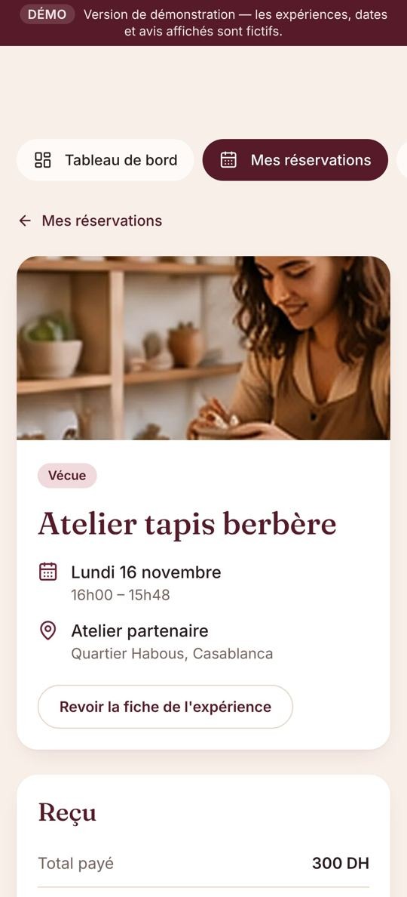
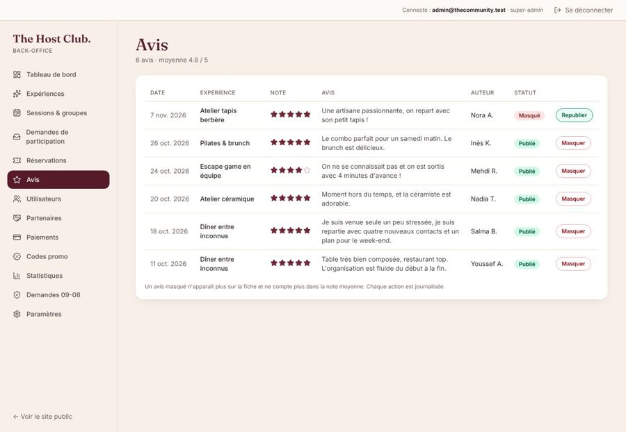
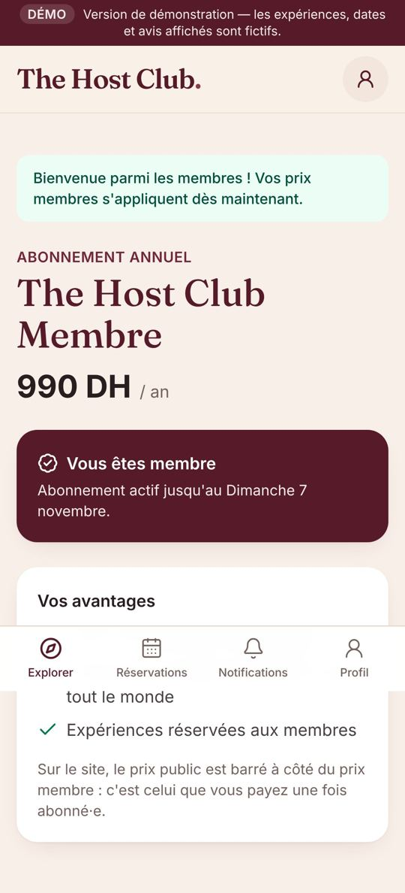
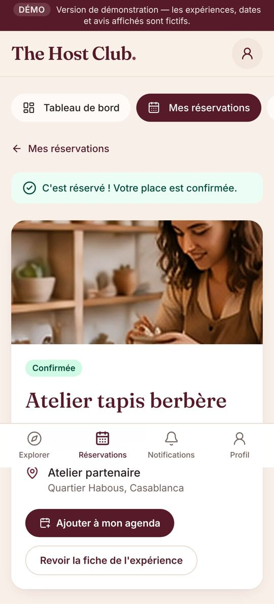
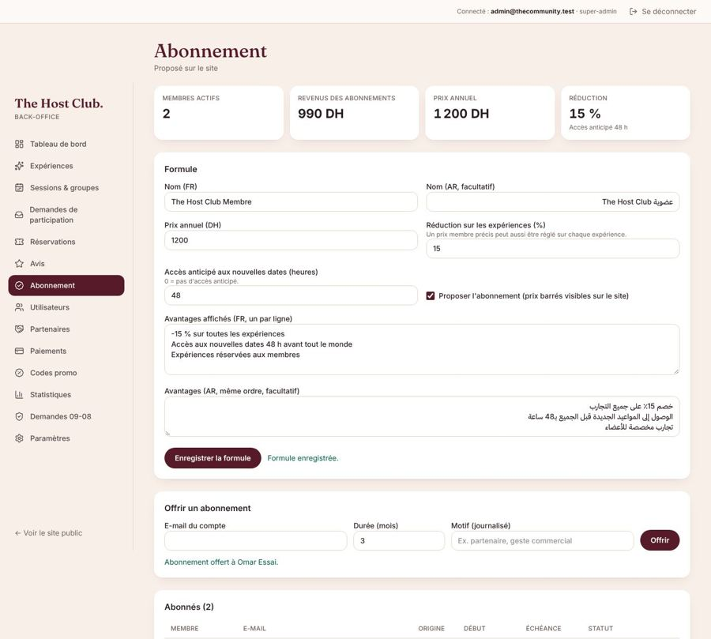

# 15 — Feuille de route après la phase 4

> Demandes de Rita du 7 novembre 2026, intégrées au plan. Chaque étape se termine par une démonstration et sa validation.
> Les choix marqués **(hypothèse)** sont des propositions : on les change facilement si besoin.

> **Règle de travail (8 novembre)** : chaque nouvelle demande est d'abord **ajoutée à ce plan**, puis réalisée **étape par étape**, sur « go » de Rita. On ne lance pas une demande dès qu'elle arrive.

## Fait

| Étape | Contenu |
|---|---|
| 1 à 4c ✅ | Site, comptes, back-office, réservations, paiement de test, demandes de participation, annulations, liste d'attente |
| 5a ✅ | Avis, fiches sans date, expériences passées listées, reproposer des dates |
| 5b ✅ | Abonnement annuel (prix membre, prix public barré, accès anticipé, réservé aux membres) |
| 5c ✅ | Factures, avoirs et reçus PDF, e-mails (boîte d'envoi de test) |
| Contenus ✅ | FAQ, centre d'aide, Devenir partenaire, version anglaise, Sécurité / CGU / CGV / Confidentialité, À propos (Aya, avec sa photo) |
| 5d ✅ | Partenaires dans le back-office : ajouter, modifier, archiver / réactiver, supprimer (super-admin, jamais un partenaire utilisé), candidature → partenaire, filtre « Archivés » |
| 5e ✅ | Paramètres : villes (ajouter, renommer fr / ar / en, ouvrir ou « bientôt », quartiers) et univers (noms, description, ordre, visibilité, mode par défaut), super-admin, journalisé |
| Accueil ✅ | Vraie photo fournie par Rita (8 novembre) |
| 5f ✅ | **Codes promo** (back-office : créer, modifier, désactiver ; % ou montant, période, plafond, première réservation ; une fois par personne, comptés au paiement) et **frais de service** (Paramètres : aucun, par place ou % ; affichés avant le paiement, jamais sur une place gratuite, remboursés avec la place). Prix détaillé au tunnel, sur la réservation et sur la facture |
| 5g ✅ | **Régime, allergies, langue(s) de table** à la réservation et sur les demandes (reprises à l'acceptation), modifiables jusqu'au début ; accord explicite et daté pour transmettre au lieu ; colonne « Accueil » des participants, export CSV, **fiche pour le lieu** imprimable (prénoms pour les marque-places, régimes, allergies, sans coordonnées) |
| 6 ✅ | **Composition des tables** : algorithme (taille, langue commune, pas de personnes déjà attablées ensemble, âges, équilibre F / H, intérêts ; réservations à plusieurs places gardées ensemble) → corrections à la main → enregistrement → **révélation** (table, prénoms et intérêts du groupe, lieu s'il était gardé secret, notification + e-mail) ; alerte « à revoir » si une réservation change ; **fiche hôte** (hôte, déroulé, 10 questions pour briser la glace, **marque-places** par table, imprimable) ; **plafond de 50 places** par date |
| 7 ✅ | **Rappels** la veille et 3 h avant (notification + e-mail, une seule fois, e-mails désactivables dans les préférences) ; **changement de date ou de lieu** : notification + e-mail ; **statistiques** par période (à venir, 30 j, 90 j, depuis le début) : CA, marge, remplissage, fidélité, note moyenne, annulations, absences, codes promo, par univers et par mois. Notifications push : en attente de la clé Web Push (docs/16) |
| 8a ✅ | **Accueil** : accroche « Your people are out there. » + « Sortez de votre routine… », « Comment ça marche » en cartes décalées (icônes des univers, bouton vers les expériences, 3 photos du groupe), **5 univers en alternance photo / texte** avec bouton « Découvrir », **« Pourquoi venir »** (grande photo + avis par-dessus, défilables), **FAQ** sous « Bientôt dans d'autres villes » puis « Vous avez d'autres questions ? » → centre d'aide |
| 8b ✅ | **Menu (ordinateur)** : Découvrir (déroulant : toutes les expériences, Dîners, Sport & bien-être, Jeux, Ateliers, Sorties ; souris, clic ou clavier), À propos, Comment ça marche, Blog. Sur mobile : barre du bas inchangée, Blog et À propos dans le pied de page |
| 8c ✅ | **Blog** « Inconnus aujourd'hui, amis demain » (EN : *Strangers Today, Friends Tomorrow* ; AR : غرباء اليوم، أصدقاء الغد) : 4 onglets — **City guide** (3 articles Casablanca + FAQ), **Conversation** (5), **Amitié** (4), **Comment fonctionne The Host Club** (7) — 19 articles rédigés par nous en FR + EN (arabe : version française affichée avec une mention, à traduire), articles liés, appel vers les expériences, référencement (titre, description, URL canonique, données structurées, plan du site) |
| 8d ✅ | **Sécurité enrichie** : ce que nous faisons, avant (prévenir un proche, prévoir le retour, besoins particuliers, payer uniquement sur le site), pendant (tout est facultatif, verre et affaires en vue, allergies à confirmer au personnel), sorties en plein air, urgence (19, 177, 15, 112 depuis un portable), après (ne jamais envoyer d'argent, rentrer en sécurité) |
| 8f ✅ | **Règles de la communauté** (`/charte`, page dédiée) : où elles s'appliquent, compte, venir ou annuler, vie privée des autres, lignes rouges (exclusion immédiate), discrimination, harcèlement, usage loyal, sujets difficiles, lieux, signalements, mesures graduées, recours sous 7 jours ; reliées depuis Sécurité, CGU, inscription, pied de page, centre d'aide et blog |
| 8g ✅ | **CGU revues** : ce que nous faisons / ce que fait le lieu (régime transmis, allergies à vérifier sur place, inclus / à vos frais, changement de lieu), ce que nous ne pouvons pas garantir, conditions pour s'inscrire, interdits, photos et vidéos **seulement avec accord**, sanctions notifiées et **recours sous 7 jours**, loi 31-08 |
| Menu mobile ✅ | **Menu burger** (validé par Rita) : barre flottante (logo, « S'inscrire » ou icône compte, burger) ; carte qui s'ouvre avec Découvrir ⌄, À propos, Comment ça marche, Blog, Villes ⌄, Se connecter / S'inscrire (ou Mon compte / Se déconnecter), langues ; Échap, focus gardé, page bloquée derrière ; barre du bas des membres conservée |
| 8i ✅ | **Blog, nouvelle mise en page** (mobile d'abord) : accroche avec la fin en couleur, thèmes en pastilles défilantes, article **« Commencer ici »** mis en avant, **« Les plus lus »** (liste compacte avec vignettes ; notre sélection tant que les lectures ne sont pas mesurées), **« Parcourir les articles »** avec tri Plus lus / Récents et **recherche sans accents** ; pages de thème (fil d'Ariane, « N articles · mis à jour le… », carte **« Rencontrer du monde à Casablanca »** avec « Trouver mon groupe » / « Choisir une autre ville », FAQ City guide, bloc **« Utile aussi »**) ; « À lire aussi » en bas des articles |
| 8h ✅ | **Confidentialité revue** : comment les données sont recueillies, **tableau finalité / base légale / durée** (régime et allergies avec accord explicite, effacés 30 jours après l'expérience ; photos avec accord ; pièces comptables 10 ans), **liste des prestataires** (Google Cloud / Firebase, Brevo, prestataire de paiement à venir), transferts hors du Maroc, droits avec réponse sous un mois, **mineurs et protection de l'enfance** ; tableaux affichés en fiches sur mobile |
| 8e ✅ | **Page À propos** : en-tête (« Des inconnus à table. *Des amis en repartant.* » + grande photo), **la créatrice** (photo à gauche, texte à droite, Instagram), **ce qui compte pour elle**, **« Nos outils pour créer du lien »** en cartes numérotées qui défilent (flèche « suivant » seule au départ, puis les deux sens ; 8 outils réels du site), **galerie** « Des rencontres qui valent mille images » (8 photos, en mosaïque) |
| 5i ✅ | **Archiver / supprimer une expérience** (back-office, fiche de l'expérience) : **Archiver** (équipe) → disparaît du site, fiche publique « Cette expérience n'est plus proposée » (non référencée, expériences du même univers proposées), historique conservé ; refusé tant qu'une date à venir a des participants, une liste d'attente ou une demande en attente ; dates vides repassées en brouillon ; filtre « Archivées », bouton **Réactiver** (en brouillon) ; une expérience archivée le reste même si on enregistre sa fiche. **Supprimer définitivement** (super-admin) → seulement sans aucun historique (réservation, demande, avis) ; efface dates, données internes, alertes et photos. Confirmation avant chaque action, journalisé |
| Arabe ✅ | **Pages encore en français traduites en arabe** (8 novembre) : textes juridiques (Sécurité, Règles de la communauté, CGU, CGV, Confidentialité), **centre d'aide** (7 catégories, 23 articles), **blog** (4 thèmes, 19 articles, FAQ City guide) ; plus de mention « traduction à venir ». Back-office : **accroche et description en arabe** pour chaque expérience (bloc « Version arabe », ouvert par défaut) |
| 5j ✅ | **Ordre des listes de l'espace membre** : annulées de la plus récente à la plus ancienne ; demandes et listes d'attente par date de l'expérience (la plus proche d'abord) ; favoris : date à venir (avec la date), puis sans date, puis **archivées en dernier** (« N'est plus proposée », grisées) |
| 10 ✅ | **Identité de marque** (docs/18) : ton & ambiance, typographie, couleurs ; logotype redessiné ; monogramme **« h. »** ; motif **« le fil »** ; papeterie, accueil des tables, affichage, objets ; **brand book version 1** (`docs/marque/brand-book.html`, fichiers SVG dans `docs/marque/`) |
| 10f ✅ | **Identité sur le site** : logo vectoriel (en-tête, menu mobile, pied de page, back-office) ; icônes « h. » (onglet, application, manifeste) ; image de partage 1200×630 ; motif « le fil » sur le bandeau des villes et l'appel du blog ; fiche hôte : marque-places au monogramme, **numéros de table**, **cartes de bienvenue** (3 questions par table) ; **chevalet « Réservé » avec QR** par partenaire ; **e-mails** avec bandeau prune, logo et motif ; **factures PDF** avec le logo vectoriel. Reste en option : page « Kit presse » |
| 11 ✅ | **Tarification en deux parts** (détail docs/19, § 8) : formulaire — section 5 « Tarification et paiement client » (tout en ligne / prix fixe sur place / consommation sur place), aperçu client en direct, avertissement « prix figé » ; fiche, cartes, tunnel, réservation : « 139 DH par personne · 59 DH maintenant · 80 DH sur place » ou « 120 DH + consommation » ; e-mail, facture (« hors facture », jamais encaissé) et CGV (FR / EN / AR) ; **billet avec QR code** ; page équipe **Billets** (scan avec l'appareil photo, code court, présence, part partenaire réglée) ; tableau de bord **En ligne / sur place** (filtres expérience, organisateur, période ; export CSV) |
| 5h phase 1 ✅ (sans RIB) | **Paiement par virement bancaire** (détail docs/19, § 9) : référence unique THC-XXXXXX, instructions à l'écran et par e-mail, place bloquée jusqu'à l'échéance (48 h, au plus tard 24 h avant ; réservation par virement fermée si la date est trop proche), page équipe **Virements** (« Virement reçu » → confirmation, billet, facture ; remboursements faits à la main → « Remboursement effectué » → avoir), e-mail si la place est libérée faute de virement, réglage **Mode de paiement** (super-admin) — **reste à faire par Rita : saisir le RIB** dans Paramètres une fois le compte pro ouvert (le site reste en paiement de test d'ici là) |
| Kit presse ✅ | **Page « Presse »** (`/presse`, lien dans le pied de page, FR / EN / AR) : présentation en 3 longueurs avec bouton « Copier », faits clés (sans chiffre inventé), fondatrice, **6 logos en SVG et PNG** (horizontal prune / crème / encre, empilé prune / crème, monogramme) avec règles d'usage, couleurs (HEX), typographies, **2 photos sans personne reconnaissable** (les autres sur demande, après accord des participants), contact presse (formulaire) |
| 11g ✅ | **Formulaire : une seule section « 4. Prix, paiement et partenaire »** (au lieu de « Partenaire et économie » + « Tarification et paiement client ») : partenaire → mode de paiement du client → bloc « Payé en ligne » (prix, prix membre, ce qu'il comprend — remplace « Ce qui est inclus ») → bloc « Payé sur place » (prix, ce qu'il comprend) → « Ce que ça nous rapporte » (équipe) adapté au mode : la part sur place n'est **jamais un coût**, nos coûts deviennent facultatifs, commission éventuelle sur la part sur place facturée au partenaire ; avertissement si coût = prix sur place ; aperçus client et équipe côte à côte. Dates → 5, photos → 6. Données rétrocompatibles |
| 11h ✅ | **Retours du 8 novembre** : (1) un seul champ **« Ce qui est inclus »**, revenu dans « 3. Format », pour tout le prix (en ligne + sur place) — l'ancien « ce que comprend la part sur place » est repris dans la liste à la prochaine modification ; (2) expériences sur demande : case **« Compte Instagram obligatoire »** (comme le message de motivation), vérifiée par le serveur ; (3) la phrase « Les réductions… s'appliquent uniquement à la part payée en ligne » **n'est plus affichée aux clients** (fiche et réservation ; elle reste dans les CGV et le back-office) |
| 13 ✅ | **Pastille de notifications non lues** : nombre en direct sur l'onglet « Notifications » de la barre du bas et sur l'icône du compte (ordinateur), « 9+ » au-delà de 9, annoncé aux lecteurs d'écran (« Notifications, 1 non lue »), effacé dès la lecture. Les notifications sur le téléphone site fermé attendent la clé Web Push (docs/16) |
| A ✅ | **Effacement automatique** du régime, des allergies et des langues de table **30 jours après l'expérience** (chaque nuit à 3 h 30), dans les réservations et les demandes de participation, comme le promet la Politique de confidentialité |
| B ✅ | **Rappel par e-mail ~12 h avant l'échéance d'un virement** (une seule fois ; rien si le virement est déjà validé ou la réservation annulée) |
| C ✅ | **Page Abonnement** : « En attente de votre virement » avec la référence, le montant, l'échéance et le lien vers les coordonnées bancaires ; pas de second achat pendant l'attente |
| D ✅ | **Revue de sécurité** : formulaires de contact et de candidature passés par le serveur (format vérifié, 5 envois par heure et 20 par jour par appareil, piège à robots, plus aucune écriture directe en base) ; en-têtes de sécurité sur tout le site (pas d'affichage dans un cadre, HTTPS imposé, caméra / micro / position refusés) ; **App Check prêt**, activé dès la clé reCAPTCHA (docs/16). Règles Firestore et Storage relues : rien d'autre à corriger |
| E ✅ (droits à donner) | **Sauvegarde complète chaque nuit** (2 h 45), gardée 14 jours dans un dossier privé ; **bilan de santé chaque matin** (8 h 10) : sauvegarde, e-mails en échec, virements en retard → carte « Santé du site » sur le tableau de bord et **e-mail aux super-admins** en cas de problème. La sauvegarde a besoin de deux droits sur le compte de service (docs/16) |
| 12 ✅ | **Page « Comment ça marche »** présentée comme la section de l'accueil (trois cartes décalées : univers, bouton vers les expériences, photos), puis les formats et la sécurité (bandeau au motif « le fil ») |
| 12b ✅ | **« Les formats » sur « Comment ça marche »** affichés comme « Cinq univers pour sortir de sa routine » sur l'accueil (photo et texte en alternance, icône, bouton « Découvrir ») — même composant que l'accueil |

## Reste à faire — ordre proposé

> 8a–8c : l'accroche « Your people are out there. » reste **en anglais dans les trois langues** (confirmé par Rita le 8 novembre). Les articles du blog citent des lieux connus de Casablanca sans adresse ni horaire (à vérifier avant de les mettre en avant). Proposition : un menu « hamburger » sur mobile pour Blog / À propos (aujourd'hui dans le pied de page) — à valider.

> Ordre proposé : **5h phase 1** (virement — RIB à demander à Rita), puis **9** (mise en production).

| Étape | Contenu | Dépend de |
|---|---|---|
| 9 | **Recette, sécurité, mise en production** (dont : **effacement automatique** du régime et des allergies 30 jours après l'expérience, annoncé dans la politique de confidentialité) | récépissé CNDP, avocat, comptable, domaine, Brevo (docs/16) |

Idées notées, à valider avant de les planifier :

- Formats **brunch** et **conversation** ; mention « en collaboration avec … » (lieu partenaire) sur la fiche.
- Après une expérience, **se revoir seulement si les deux le souhaitent** (décision D8 : pas de messagerie au lancement).
- **Arabe, reste à traduire** : les e-mails et notifications envoyés par le site (aujourd'hui en français), les factures PDF, et le contenu de chaque expérience (à saisir dans le back-office, bloc « Version arabe »).

---

## Ajouts du 7 novembre (exemples Sahbi et Timeleft)

Inspirations à reprendre **à notre façon** (sans copier) :

| Idée | Où | Statut |
|---|---|---|
| FAQ courte (10 questions max) : prix, langues, régime alimentaire, abonnement, sécurité | /faq | ✅ |
| Pages **Sécurité**, **Conditions d'utilisation**, **Confidentialité** (et CGV), avec un bloc « Informations légales et contacts » | pied de page, /securite, /cgu, /cgv, /confidentialite | ✅ projets à valider (infos à fournir : docs/16) |
| Version **anglaise** du site | sélecteur FR · عربي · EN, adresses /en/… ; prix affichés en « MAD » ; fiches d'expériences encore en français tant qu'elles ne sont pas traduites dans le back-office | ✅ |
| **Centre d'aide** façon Timeleft : recherche, onglets **Clients / Partenaires**, catégories (Bien démarrer, Abonnement, Expériences et réservations, Compte, Sécurité, Partenariats), articles, « Cet article vous a-t-il aidé ? », articles liés | /aide, /aide/partenaires, /aide/{article} ; retours lus dans le back-office (Centre d'aide) | ✅ 23 articles FR + EN (arabe à traduire) |
| **Programme partenaires** : « Devenir partenaire », nos critères (ambiance propice à la conversation, réputation, emplacement central, lieux indépendants, accueil de petits groupes), formulaire de candidature, aide partenaires (gestion des réservations, signaler un problème : absences, retards, comportement) | /devenir-partenaire, /aide/partenaires ; candidatures lues dans le back-office (Partenaires) | ✅ candidature + articles ; espace partenaire en ligne : plus tard |
| **Régime alimentaire / allergies** demandés à la réservation et transmis au lieu | tunnel de réservation, fiche pour le lieu | ✅ 5g |
| **Langue(s) de la table** choisie(s) à la réservation pour mieux composer les groupes | tunnel ✅ (5g) ; utilisation par la composition des tables : étape 6 | en partie |
| « Se rencontrer d'abord » : après la table, **contacts échangés seulement si les deux le souhaitent** | espace membre (après phase 6) | idée à valider (décision D8 : pas de messagerie au lancement) |
| Lien **Instagram d'Aya Snoussi** | pied de page, À propos | ✅ fondatrice |
| Page **À propos** : Aya Snoussi, créatrice (son parcours, ce qui compte pour elle), d'après l'article CULTIQ, réécrit à notre façon | /a-propos | ✅ texte à valider par Aya ; photo recadrée depuis l'article (image 1) |

Idées tirées de l'article CULTIQ sur Aya (8 novembre) — l'esprit de ses rencontres, à traduire dans le produit :

| Idée | Où | Statut |
|---|---|---|
| **Prénom de chacun à sa place** (marque-place) : imprimer / afficher la liste des prénoms par table pour l'hôte et le lieu | back-office, page de session (export « marque-places ») | à faire (phase 6, avec les groupes) |
| **Accueil par l'hôtesse et présentations** : fiche « hôte » par date (qui accueille, déroulé, questions pour briser la glace) | back-office, session | à faire |
| **Formats variés** : dîner, **brunch**, atelier, **conversation** — ajouter « brunch » et « conversation » aux types d'expériences si besoin | catalogue | à valider |
| **Rester à taille humaine** : plafond de participants par événement (moins de 50) et groupes de table de 5 à 8 | règles de création d'expérience | à valider (capacité max actuelle : 500) |
| **Un vrai lien** : après l'expérience, proposer de revoir quelqu'un du groupe seulement si les deux le souhaitent (voir « Se rencontrer d'abord ») | espace membre | idée à valider (D8) |
| **Plus de demandes que de places** : expériences « sur demande » et liste d'attente | /reserver | ✅ déjà en place (demandes, liste d'attente) |
| Mettre en avant les **collaborations avec des lieux** (ex. brunch dans un restaurant partenaire) sur la fiche : « en collaboration avec … » | fiche expérience | à faire |
| **Image d'accueil** nette | accueil | ✅ illustration originale (à remplacer par de vraies photos) |

### Livré (centre d'aide, version anglaise)

- **Version anglaise** complète (`/en/…`) ; sélecteur FR · عربي · EN en haut et en bas de page ; dates en 24 h, prix en « MAD ».
- **Centre d'aide** (`/aide`) : recherche instantanée (sans accents), onglets **Membres / Partenaires**, 7 catégories, 23 articles rédigés à partir des vraies règles du site (délais de 15 min, 24 h, 4 h, 48 h, 60 jours, renouvellement 30 jours avant). « Cet article vous a-t-il aidé ? » : retour anonyme enregistré, consultable dans le back-office → **Centre d'aide** (les articles jugés peu utiles remontent en premier).
- **Devenir partenaire** (`/devenir-partenaire`) : formulaire de candidature (type d'activité, ville, contact, présentation) ; les candidatures apparaissent dans le back-office → **Partenaires**.
- Contenus : `apps/web/content/help.ts` (français de référence, anglais ; arabe à traduire — la version française s'affiche avec une mention).
- Tests : règles Firestore (2 nouveaux), `tests/e2e/aide.e2e.cjs` (démo) et `tests/e2e/firebase-aide.e2e.cjs` (émulateurs).

## 5a — Avis, fiches sans date, expériences passées

### Avis
- Qui peut noter : une personne **pointée présente**, ou dont la réservation était confirmée et l'expérience **terminée** (si l'équipe n'a pas pointé). Pas les absents.
- Un avis par réservation : **note de 1 à 5** et commentaire (facultatif, 1 000 caractères). Signé « Prénom + initiale » (ex. « Sara B. »).
- L'avis **reste attaché à l'expérience** (pas seulement à la date) : affiché sur sa fiche, avec la note moyenne, même quand il n'y a plus de date à venir.
- Dans l'espace membre : « Votre avis » sur la réservation passée, et une liste « À noter ». Notification in-app le lendemain de l'expérience (l'e-mail viendra avec 5c/7).
- Back-office : liste des avis, **masquer** un avis inapproprié (journalisé).

### Fiches sans date et expériences passées
- Créer une expérience **sans date** : la fiche est publiée avec « Prochaines dates bientôt ».
- Sur la fiche admin, **« Ajouter des dates »** à tout moment (une date ou une récurrence) ; c'est aussi le moyen de **reproposer** une expérience passée.
- Le catalogue liste **toutes les expériences publiées** : d'abord celles qui ont une date à venir, puis « **Déjà vécues** » (avec leurs avis et « Dernière édition : 12 octobre »).
- Sur une fiche sans date à venir : bouton **« Me prévenir des prochaines dates »** ; quand l'équipe ajoute une date, les personnes inscrites reçoivent une notification.

### Livré (5a) ✅

| Pour qui | Ce qui change |
|---|---|
| **Équipe** | Fiche expérience : case **« Programmer des dates maintenant »** (décochée = fiche publiée sans date) ; section **« Ajouter des dates (ou reproposer l'expérience) »** sur toute fiche existante. Liste des expériences : **« Aucune — ajouter des dates »** pour celles sans date à venir. Nouvelle page **Avis** : lire, **masquer** / republier (note recalculée, journalisé). |
| **Visiteur** | Catalogue : section **« Déjà vécues — de nouvelles dates arrivent »** (cartes « Prochaines dates bientôt » avec note moyenne). Fiche sans date : **« Me prévenir des prochaines dates »** ; « Éditions passées » (nombre et dernière date) ; les avis restent affichés. |
| **Membre** | Le lendemain de l'expérience : notification **« Comment s'est passée votre expérience ? »** ; sur la réservation passée : **note 1 à 5 + avis**, publié sur la fiche avec « Prénom N. ». Tableau de bord : « À noter ». Notification quand une expérience suivie a de nouvelles dates. |

Règles : un avis par réservation ; personnes pointées présentes, ou confirmées une fois l'expérience terminée ; jamais les absents ; dans les **60 jours** (hypothèse). Sur la fiche publique, un nouvel avis apparaît dans les 5 minutes (cache du catalogue) ; l'auteur le voit tout de suite.

| Avis (membre) | Modération (équipe) |
|---|---|
|  |  |

Tests : 6 tests d'intégration (éligibilité, note moyenne exacte, doublon, modération, demande d'avis unique, création sans date, alerte unique) et 20 vérifications de bout en bout (`tests/e2e/firebase-reviews.e2e.cjs`). Toutes les suites : 84 sur émulateurs, 37 unitaires, 150 de bout en bout en mode Firebase, 60 en démonstration.

## 5b — Abonnement annuel

Proposition de construction (à valider) :

- **Une formule** au lancement (ex. « The Host Club Membre »), prix **annuel** réglé par l'admin. L'architecture permet plusieurs formules plus tard.
- **Avantages réglables par l'admin** :
  - **réduction** sur les expériences : un pourcentage global **(hypothèse : 15 %)**, ou un **prix membre précis** par expérience (prioritaire sur le pourcentage) ;
  - **accès anticipé** aux nouvelles dates (ex. 48 h avant le public) — facultatif ;
  - **expériences réservées aux membres** — case à cocher par expérience ;
  - texte des avantages (FR/AR) affiché sur la page d'abonnement.
- **Affichage** : partout où un prix apparaît, le **prix public est barré** à côté du **prix membre** (pour tout le monde : c'est l'argument de vente), avec « Devenir membre ». Un abonné voit « Votre prix membre » et paie ce prix.
- **Souscription** : page « Abonnement » → paiement (même parcours que les réservations, adaptateur de test en attendant la banque) → abonnement actif **12 mois**. **Pas de prélèvement automatique** (les prestataires marocains le proposent rarement) : rappel avant l'échéance et renouvellement en un clic **(hypothèse)**.
- **Le prix est toujours calculé par le serveur** au moment de la réservation (abonnement actif vérifié) et figé dans la réservation.
- **Back-office** : réglages de la formule, liste des abonnés (dates, renouvellements), offrir / retirer un abonnement (journalisé), revenus des abonnements dans les statistiques.
- Espace membre : **carte de membre** (statut, date d'échéance, économies réalisées).
- À faire valider par le comptable et l'avocat : CGV de l'abonnement (rétractation, remboursement), TVA.

### Livré (5b) ✅

| Pour qui | Ce qui change |
|---|---|
| **Équipe** | Back-office → **Abonnement** : nom, **prix annuel**, **réduction** (%), **accès anticipé** (heures, 0 = aucun), avantages FR/AR, case **« Proposer l'abonnement »** ; membres actifs, revenus, liste des abonnés ; **offrir** un abonnement (1-24 mois) ou le **retirer** (motif journalisé). Fiche expérience : **« Prix membre (DH) »** facultatif (sinon la réduction s'applique) et **« Réservée aux membres abonnés »**. |
| **Visiteur** | Partout (cartes, fiche, tunnel) : **prix public barré** à côté du **prix membre** (arrondi au dirham), lien « Devenir membre ». Page **Abonnement** (lien dans le pied de page et l'espace membre) : avantages, prix, souscription. |
| **Membre** | Souscription → paiement (adaptateur de test) → **abonnement actif 12 mois**, notification, carte de membre (échéance, **économies réalisées**). Le **prix membre est appliqué par le serveur** à chaque réservation (aussi pour une place proposée par la liste d'attente) et apparaît sur le reçu (« Réduction membre »). Accès aux expériences **réservées aux membres** et aux **nouvelles dates en avant-première**. Renouvellement en un clic **30 jours avant** l'échéance (la nouvelle année part de l'échéance) ; **pas de prélèvement automatique**. |

| Membre | Reçu | Back-office |
|---|---|---|
|  |  |  |

**Sur le projet d'essai, l'abonnement est créé mais pas encore proposé** : back-office → Abonnement → régler le prix → cocher « Proposer l'abonnement » → Enregistrer.

À venir : rappel avant l'échéance (avec les e-mails, 5c/7), remboursement d'un abonnement (au cas par cas pour l'instant).

Tests : 6 tests d'intégration et 4 unitaires (formule, souscription et renouvellement, prix membre, réservé aux membres, accès anticipé, cadeau / retrait, offre de liste d'attente au prix membre, règles de sécurité) ; 24 vérifications de bout en bout (`tests/e2e/firebase-membership.e2e.cjs`). Toutes les suites : 90 sur émulateurs, 41 unitaires, 172 de bout en bout en mode Firebase, 60 en démonstration.

## 5c — Factures et e-mails

### Livré (8 novembre)

- **Un document pour chaque paiement** (réservation, abonnement) et **un avoir pour chaque remboursement**, émis automatiquement par le serveur, une seule fois, avec un **numéro continu sans trou** attribué dans la même transaction que le document.
- **Trois séries**, jamais mélangées :
  - `TEST-FA-2026-000001` / `TEST-AV-…` : paiements de test (c'est le cas aujourd'hui) — « Reçu de TEST, aucun paiement réel » ;
  - `RE-…` / `RA-…` : vrai paiement mais société pas encore renseignée — « Reçu, projet d'essai, sans valeur de facture » ;
  - `FA-2026-000123` / `AV-…` : vraies factures et avoirs (vrai paiement **et** société renseignée).
- **PDF** (A4) : émetteur (raison sociale, siège, ICE, IF, RC), client, détail (places, date, remise membre), total HT / TVA / TTC, date de paiement, mentions. Rangé dans un espace privé ; téléchargeable uniquement par la personne concernée et l'équipe.
- **Membre** : rubrique **« Mes factures »** dans l'espace, et « Facture et documents » sur chaque réservation.
- **E-mails** (français, anglais ou arabe selon la langue du compte) : confirmation de réservation + facture, abonnement + facture, remboursement + avoir, PDF en pièce jointe.
  Tant que Brevo n'est pas branché, ils sont rangés dans la **boîte d'envoi de test** du back-office (aperçu exact de ce que le membre recevra) ; **personne ne les reçoit**.
- **Back-office** :
  - **Paiements** : numéro du document, téléchargement, « Renvoyer par e-mail » ou « Émettre le document » pour un paiement antérieur (journalisé).
  - **Boîte d'envoi** : tous les e-mails, avec aperçu.
  - **Paramètres → Société et envoi des e-mails** (super-admin) : raison sociale, siège, ICE (15 chiffres), IF, RC, e-mail, taux de TVA, expéditeur, choix « boîte d'envoi de test » / « Brevo ». Les informations sont figées sur chaque nouveau document ; un document émis ne change jamais.
- **Sécurité** : documents, compteurs et e-mails écrits par le serveur seulement ; compteurs illisibles ; boîte d'envoi lisible par l'équipe seulement ; PDF jamais lisibles directement dans Storage.
- Tests : 6 unitaires (numérotation, séries, TVA, lignes), 7 sur émulateurs (règles, émission, numéros simultanés, avoir, société, abonnement), 23 vérifications de bout en bout (`tests/e2e/firebase-factures.e2e.cjs`).

**Brancher Brevo** (le jour venu, sans changer le code de l'envoi) : créer le compte et vérifier le domaine d'envoi → enregistrer la clé comme secret Cloud `BREVO_API_KEY` (jamais dans le chat ni dans le code) → l'ajouter aux fonctions qui envoient (une ligne de configuration, je m'en charge) → choisir « Brevo » dans Paramètres.

À faire valider par le comptable : mentions obligatoires, taux de TVA (places, abonnement ; cas des commissions), conservation des documents.

### Plan initial

- **Une facture pour chaque paiement** (réservation, abonnement) et un **avoir** pour chaque remboursement, avec une **numérotation continue sans trou** (ex. `FA-2026-000123`, `AV-2026-000012`), attribuée par le serveur.
- Contenu : identité de la société (raison sociale, siège, ICE, IF, RC — saisis par le super-admin dans **Paramètres → Société**), client, détail, montants HT / TVA / TTC, moyen de paiement.
  Tant que la société n'existe pas, le document s'intitule **« Reçu — projet d'essai »** et n'a pas valeur de facture.
- **PDF** généré par le serveur, stocké de façon privée (visible par la personne et l'équipe seulement).
- Membre : bouton **« Télécharger la facture »** sur chaque réservation et page **« Mes factures »**. Équipe : factures depuis **Paiements**, bouton **« Renvoyer par e-mail »**.
- **Envoi par e-mail** automatique après paiement et remboursement, via un service d'envoi interchangeable :
  en attendant le compte Brevo, les e-mails sont rangés dans une **boîte d'envoi de test** consultable dans le back-office (rien n'est réellement envoyé) ; brancher Brevo = enregistrer sa clé, sans changer le code.
- À faire valider par le comptable : mentions obligatoires, taux de TVA applicables (places, commissions, abonnement), conservation.

---

## Corrections faites le 7 novembre

- **Annulation impossible depuis le téléphone** : la confirmation utilisait une fenêtre système que certains navigateurs intégrés (WhatsApp, Instagram) bloquent sans l'afficher. Toutes les confirmations se font désormais **dans la page** (« Oui, annuler » / « Non, garder ma place »), y compris dans le back-office. Les tests de bout en bout refusent maintenant toute fenêtre système, pour que le problème ne revienne pas.
- **« Mes réservations » en erreur pendant ~1 minute** juste après la mise en ligne de la 4b : un index de la base était encore en construction. Il est prêt ; à l'avenir, le délai de construction des nouveaux index est à prévoir lors des mises en ligne (quelques minutes).

## Hypothèses retenues en 5f et 5g (modifiables)

- Code promo : réservations directes uniquement (pas sur les demandes ni les offres de liste d'attente) ; s'applique après le prix membre ; une fois par personne ; arrondi au dirham pour les pourcentages.
- Un code est compté au paiement (ou tout de suite si la place devient gratuite) : deux paiements quasi simultanés peuvent dépasser le plafond d'une unité.
- Frais de service : sur toutes les réservations payantes (directes, demandes acceptées, liste d'attente), remboursés avec la place.
- Allergies (donnée de santé) : transmises au lieu seulement avec l'accord coché, daté ; visibles par l'équipe.
